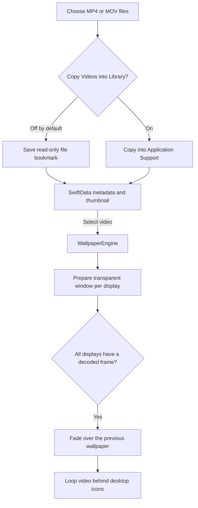

# Loopmural: macOS Video Wallpaper App

**Loopmural** is a lightweight, privacy-focused macOS menu bar app that turns local MP4 and MOV files into moving desktop wallpapers. Built with **SwiftUI**, **SwiftData**, **AppKit**, and **AVFoundation**, it keeps video playback behind desktop icons while offering a small library in the menu bar.

This article breaks down the desktop window design, video linking and importing, smooth playback transitions, and context menus. The familiar menu bar foundations are covered briefly in [C2V: MacOS Status Bar App](/page/c2v-macos-status-bar-app).



---

## App Summary & Links

### What is Loopmural?

Loopmural keeps a library of local videos with thumbnails, durations, pinned favorites, and editable display names. Users can set a video as wallpaper, pause or resume it, and optionally restore the last selection when the app opens.

The app runs on **macOS 15 or later**. Its video processing, library, and preferences stay on the Mac, with no analytics or app-managed cloud synchronization.

https://apps.apple.com/jp/app/loopmural/id6821934534
https://github.com/jinyongnan810/Loopmural

### Shared Foundations with C2V

Both apps use SwiftUI's `MenuBarExtra` with `.window` styling, a template menu bar icon, and an agent-style lifecycle without a Dock icon. They also share local SwiftData persistence, `SMAppService` for launch at login, Liquid Glass styling with fallbacks, and in-window overlays for dialogs.

Loopmural's additional engineering lives mainly in two files: **`WallpaperLibrary.swift`** manages files and library state, while **`WallpaperEngine.swift`** owns desktop windows and playback.

---

## How Desktop Video Basically Works

Loopmural displays a video in a borderless AppKit window covering each screen. The window sits above the system desktop background and below desktop icons. An `AVPlayerLayer` inside it draws the video frames.

The key window configuration is:

```swift
window.level = NSWindow.Level(rawValue: Int(CGWindowLevelForKey(.desktopWindow)) + 1)
window.collectionBehavior = [.canJoinAllSpaces, .stationary, .ignoresCycle]
window.ignoresMouseEvents = true
```

The window cannot become the key or main window, has no shadow, and stays visible when the app loses focus. Ignoring mouse events lets users continue clicking and dragging desktop icons normally.

The video layer uses:

```swift
playerLayer.videoGravity = .resizeAspectFill
```

This fills the screen while preserving the video's proportions. Parts outside the screen are cropped, so a video with a different aspect ratio will lose some content around its edges.

For ordinary looping, each display session uses an **`AVQueuePlayer` with `AVPlayerLooper`**. The looper manages repeated playback of the video item. Each display has its own window and player; the app does not implement frame-locked synchronization between displays.

**The app must remain running.** These windows do not change the macOS wallpaper setting or the lock-screen wallpaper. macOS controls their behavior during Spaces, Mission Control, and Stage Manager transitions.

---

## Importing or Linking Videos

### 1. Choose Files from the Menu Bar

Clicking **+** opens an `NSOpenPanel` that accepts multiple MP4 or MOV files:

```swift
panel.allowedContentTypes = [.mpeg4Movie, .quickTimeMovie]
panel.allowsMultipleSelection = true
panel.canChooseDirectories = false
```

The extension filter is only the first check. The library also loads the asset asynchronously and verifies that it is playable, has a video track, and has a finite, positive duration.

### 2. Link by Default, Copy When Needed

The **Copy Videos into Library** setting determines how newly added videos are stored:

| Mode              | What Loopmural stores                                                | What the user needs to keep                                    |
| ----------------- | -------------------------------------------------------------------- | -------------------------------------------------------------- |
| Link, the default | A persistent read-only bookmark to the original file                 | The original video and access to its drive                     |
| Copy              | An independent video copy in the app's Application Support directory | The app-owned copy; playback no longer depends on the original |

Changing the setting affects future additions. Existing copied videos remain copies.

Because Loopmural runs in the App Sandbox, remembering a path alone is insufficient for durable access to a user-selected file. A **security-scoped bookmark** preserves that access across launches:

```swift
try url.bookmarkData(
    options: [.withSecurityScope, .securityScopeAllowOnlyReadAccess],
    includingResourceValuesForKeys: nil, relativeTo: nil
)
```

When the video is needed, the library resolves the bookmark, refreshes it if stale, and starts security-scoped access. Playback sessions retain their own access until they close, including while an outgoing wallpaper finishes its transition. This prevents access from ending as soon as the import operation completes.

If a linked video becomes unavailable, reconnect its drive or use **Locate File…** to select a replacement and save a new bookmark. Removing a library entry or clearing the library deletes app-owned copies but leaves linked originals untouched.

### 3. Save Metadata and Prepare a Thumbnail

SwiftData stores the video's ID, display name, duration, import date, pin state, bookmark or owned filename, and thumbnail. The video bytes themselves remain in the original file or app-owned copy.

The library skips repeated imports with the same standardized source path, file size, and modification date. This is a source identity check, so identical content at a different path can still be added.

Large copies and thumbnail generation run away from the main actor to keep the menu responsive. `AVAssetImageGenerator` produces a preview capped at 720 × 405 pixels; a missing thumbnail does not prevent importing a valid video. The last successfully imported video is applied automatically, and the saved wallpaper selection changes only after playback startup succeeds.

---

## Smoothly Switching Wallpapers

A playable asset may still need time to decode its first visible frame. Revealing its window immediately can briefly show an empty black layer.

Loopmural handles replacement in four stages:

1. **Prepare incoming windows at zero opacity** while the current wallpaper remains visible.
2. **Wait for a decoded frame on every display**, checking `AVPlayerLayer.isReadyForDisplay` about every 20 ms, with a 10-second deadline.
3. **Fade incoming windows over the outgoing ones** over 0.8 seconds. Initial startup uses a 1-second fade.
4. **Close the outgoing sessions after the fade**, releasing their players, layers, windows, and file access.

The essential readiness condition is:

```swift
while !prepared.allSatisfy(\.isReadyForDisplay) {
```

The full loop also checks cancellation, the deadline, and whether a newer request has superseded this one. Each startup receives a generation UUID, so an older preparation cannot install itself after the user selects another video or presses Stop.

**Keep the outgoing wallpaper fully opaque underneath the incoming fade.** Fading both windows simultaneously would expose the desktop background between them. Outgoing playback can continue during replacement, but its audio is muted immediately.

If validation or preparation fails, uninstalled sessions are closed and the previous wallpaper stays installed. With Reduce Motion enabled, the window fade duration becomes zero.

---

## Smoothly Looping from End to Start

Switching between wallpapers and hiding a video's loop seam are separate problems. `AVPlayerLooper` repeats playback, but a visible jump remains if the video's final frame differs from its first frame.

The optional **Smooth Loop** setting uses **two players and two layers per display**. One plays the current cycle while the other waits at the beginning. The overlap is deliberately short:

```swift
overlap = min(0.5, duration / 4)
```

For a 10-second clip, the blend starts near 9.5 seconds. Once the standby player's rewind has completed and its layer is ready, it starts playing above the still-opaque outgoing layer.

The incoming layer's opacity follows its **media playback time**:

```swift
let progress = min(max(players[next].currentTime().seconds / overlap, 0), 1)
videoView.setBlend(progress: Float(progress), incoming: next)
```

At zero progress, the outgoing frame is visible. At one, the incoming frame fully covers it. Using media time means a decoding stall also stalls the fade, and pausing preserves its position. Layer updates disable implicit Core Animation actions so an extra animation does not lag behind the calculated opacity.

After the blend, the players swap roles. The hidden outgoing player pauses and seeks to zero; it becomes reusable only after that seek succeeds. The incoming player continues from the time it has already reached, so each cycle is shortened by the overlap.

A boundary-time observer waits until the overlap begins. Only the blend uses updates roughly every 16 ms, and that work stops while paused or asleep.

Sound is off by default. If enabled, the two players use complementary audio gains during the blend, and only the first display outputs sound. Reduce Motion disables Smooth Loop for newly created sessions.

This approach softens the seam but cannot make unrelated endpoints match. Similar framing and lighting at the start and end still produce the best result. Two players per display also increase playback resources, especially while replacing an existing wallpaper.

---

## How Context Menus Work

### Video Row: SwiftUI `.contextMenu`

Each video row exposes **Set as Wallpaper**, **Pin/Unpin**, **Rename…**, and **Remove from Library…**. Linked videos also offer **Locate File…**. A short excerpt shows the direct connection between menu items and actions:

```swift
.contextMenu {
    Button("Set as Wallpaper", action: onSet).disabled(isBusy)
    Button("Rename…", action: onRename).disabled(isBusy)
    Button("Remove from Library…", role: .destructive, action: onRemove)
        .disabled(isBusy)
}
```

The row also has a hover-revealed ellipsis `Menu` for pinning, locating, renaming, and removal. Both menus call the same library or view actions, and disable actions while the library is busy.

Choosing removal opens an in-window confirmation overlay before deleting anything. Renaming edits the library display title while preserving the underlying file and identity.

### Menu Bar Icon: AppKit `NSMenu`

The status bar icon uses the same bridge described in C2V. A local `NSEvent` monitor recognizes right-click and Control-click, then searches the event window's view hierarchy for an `NSStatusBarButton`. Unrelated events pass through unchanged.

For a matching click, it presents a native menu containing **Settings** and **Quit Loopmural**, then consumes the event:

```swift
showContextMenu(for: button, event: event)
return nil
```

Returning `nil` prevents the normal popover toggle from also running. Inside the helper, AppKit displays the menu beside the button:

```swift
NSMenu.popUpContextMenu(menu, with: event, for: button)
```

An invisible SwiftUI bridge in the icon's background provides the `openSettings` environment action. The menu callback activates the app and invokes that action, bringing Settings to the foreground. The event monitor is removed when the app terminates.

---

## Display Changes, Sleep, and Cleanup

Continuous desktop playback also needs to respond to the Mac's lifecycle:

| Event                                                 | Behavior                                                                                                                                      |
| ----------------------------------------------------- | --------------------------------------------------------------------------------------------------------------------------------------------- |
| Display configuration changes                         | Capture the current playback position and pause state, then prepare replacement sessions for the current screens. Seek before revealing them. |
| Display sleep, system sleep, or inactive user session | Pause playback while preserving the user's pause preference. Resume only after all suspension reasons clear and the user has not paused.      |
| Stop                                                  | Cancel pending startup, fade current windows out over 0.7 seconds, and clear the saved selection.                                             |
| Quit                                                  | Close playback resources and observers while preserving the selection and pause preference for optional restoration next launch.              |

Session cleanup is safe to call repeatedly. It cancels loop work, removes observations, disables the looper, releases player items and layers, closes the window, and ends retained file access.

---

## Mac App Store Release Tips: App Preview Uploads

When uploading the English and Japanese previews, I encountered Apple's `ASSET_FAILED` processing error. The following checks helped resolve the failures and verify that both previews were accepted.

### 1. Check Encoding, Not Just the File Extension

The original English MOV used H.264 Level 4.2 at roughly 45 fps; the Japanese MOV used HEVC at roughly 51 fps. Their dimensions and durations were valid, but their encoding settings needed changing.

The HandBrake export checklist was:

| Setting               | Value                                       |
| --------------------- | ------------------------------------------- |
| Container             | MP4                                         |
| Dimensions            | 1920 × 1080, with cropping off              |
| Video encoder         | H.264 (x264)                                |
| Profile / level       | High / 4.0                                  |
| Frame rate            | Explicitly select 30 and Constant Framerate |
| Average video bitrate | 10,000–12,000 kbps                          |
| Audio                 | AAC stereo, 256 kbps, 48 kHz                |

Apple lists H.264 up to High Profile Level 4.0, a maximum of 30 fps, and 1920 × 1080 for Mac previews. Check the [App preview specifications](https://developer.apple.com/help/app-store-connect/reference/app-information/app-preview-specifications/) before exporting. In HandBrake, choosing **Same as source** can preserve the excessive frame rate. Existing exports can be converted; using the original recording simply avoids another generation of video compression.

### 2. A Silent Preview Can Still Need an Audio Track

The converted H.264 Level 4.0 MP4s still returned `ASSET_FAILED`. Neither contained an audio track. Adding a **silent stereo AAC track** was the final change before both uploads succeeded.

For an already-converted video with no audio, this command creates a new preview without re-encoding its video stream:

```bash
ffmpeg -i "INPUT_VIDEO" \
  -f lavfi -i anullsrc=channel_layout=stereo:sample_rate=48000 \
  -map 0:v:0 -map 1:a:0 \
  -c:v copy -c:a aac -b:a 256k \
  -shortest -movflags +faststart "OUTPUT_PREVIEW"
```

Replace `INPUT_VIDEO` and `OUTPUT_PREVIEW` with the input and output MP4 paths, and repeat for each language. FFmpeg's [`anullsrc`](https://ffmpeg.org/ffmpeg-filters.html#anullsrc) generates silence; `-c:v copy` preserves the encoded video, and `-shortest` ends the output with the video. This step adds audio only—it does not fix video encoding or frame-rate problems.

Apple's error did not identify the missing track explicitly. Adding silence resolved these two uploads, so it is a useful troubleshooting step for this case rather than a diagnosis for every `ASSET_FAILED` error.

### 3. Upload to the Correct Localization and Verify Processing

`--version-localization` takes the **App Store version localization resource ID**, not the locale text `en-US` or `ja`. First list the localizations for the intended version:

```bash
asc localizations list --version "VERSION_ID" --locale "en-US,ja" --output json
```

Here, `VERSION_ID` is the version's resource ID, not its display version number. Use each result's `data[].id` for its matching language:

```bash
asc video-previews upload --version-localization "EN_LOCALIZATION_ID" \
  --path "PREVIEW_PATH" --device-type DESKTOP --skip-existing --output json
```

Replace `PREVIEW_PATH` with the exported preview path and repeat for each localization. `DESKTOP` targets the Mac preview set, and `--skip-existing` skips files with matching MD5 checksums when retrying.

Both localized previews ultimately returned **`COMPLETE`**. Check the processing result as well as the transfer: reaching Apple does not by itself mean the preview was accepted.
