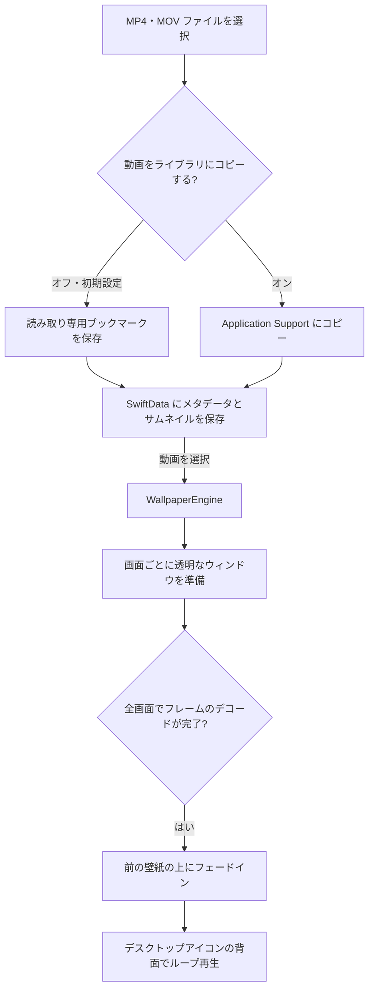

# Loopmural: macOS 動画壁紙アプリ

**Loopmural** は、ローカルの MP4・MOV ファイルを動くデスクトップ壁紙にできる、軽量でプライバシー重視の macOS メニューバーアプリです。**SwiftUI**、**SwiftData**、**AppKit**、**AVFoundation** を組み合わせ、メニューバーから動画ライブラリを操作しながら、デスクトップアイコンの背面で動画を再生します。

本稿では、デスクトップ用ウィンドウの設計、動画のリンクと取り込み、滑らかな切り替え、コンテキストメニューの仕組みを解説します。メニューバーアプリとしての共通部分は簡単に触れるにとどめ、詳しくは [C2V: macOS ステータスバーアプリ](/page/c2v-macos-status-bar-app) に譲ります。



---

## アプリ概要とリンク

### Loopmural とは？

Loopmural は、サムネイル、再生時間、ピン留め、表示名の変更に対応したローカル動画ライブラリを提供します。動画を壁紙に設定し、一時停止・再開できるほか、アプリ起動時に前回の選択を復元することもできます。

対応 OS は **macOS 15 以降**です。動画処理、ライブラリ、設定は Mac 内で完結し、アナリティクスやアプリ独自のクラウド同期は行いません。

- **Mac App Store**: [Loopmural をダウンロード](https://apps.apple.com/jp/app/loopmural/id6821934534)
- **ソースコード**: [GitHub リポジトリ](https://github.com/jinyongnan810/Loopmural)

### C2V と共通する基盤

両アプリとも、SwiftUI の `MenuBarExtra` を `.window` スタイルで使用し、テンプレート形式のメニューバーアイコンと、Dock に表示しないエージェント型のライフサイクルを採用しています。ローカルの SwiftData 永続化、`SMAppService` によるログイン時の起動、旧 OS 向けの代替表示を備えた Liquid Glass、ダイアログ用のウィンドウ内オーバーレイも共通です。

Loopmural 固有の処理は主に 2 つのファイルに分かれています。**`WallpaperLibrary.swift`** がファイルとライブラリの状態を管理し、**`WallpaperEngine.swift`** がデスクトップ用ウィンドウと動画再生を担当します。

---

## デスクトップで動画が動く基本的な仕組み

Loopmural は、各画面全体を覆う枠なしの AppKit ウィンドウに動画を表示します。ウィンドウの位置は、システムのデスクトップ背景より手前、デスクトップアイコンより奥です。その内部に配置した `AVPlayerLayer` が動画フレームを描画します。

中心となるウィンドウ設定は次の 3 行です。

```swift
window.level = NSWindow.Level(rawValue: Int(CGWindowLevelForKey(.desktopWindow)) + 1)
window.collectionBehavior = [.canJoinAllSpaces, .stationary, .ignoresCycle]
window.ignoresMouseEvents = true
```

このウィンドウはキーウィンドウやメインウィンドウにはならず、影を表示せず、アプリが非アクティブになっても表示を維持します。マウスイベントを無視するため、ユーザーは普段どおりデスクトップアイコンをクリックしたり、ドラッグしたりできます。

動画レイヤーには次の設定を使用します。

```swift
playerLayer.videoGravity = .resizeAspectFill
```

動画の縦横比を保ちながら画面全体を埋め、はみ出す部分を切り取ります。画面と動画の縦横比が異なる場合、動画の端が一部見えなくなります。

通常のループ再生では、画面ごとの再生セッションが **`AVQueuePlayer` と `AVPlayerLooper`** を使用します。`AVPlayerLooper` が動画アイテムの繰り返し再生を管理します。各画面は独立したウィンドウとプレイヤーを持ち、複数画面のフレーム単位での同期は実装していません。

**動く壁紙を表示するには、アプリを起動したままにする必要があります。** macOS の壁紙設定やロック画面の壁紙は変更しません。Spaces、Mission Control、Stage Manager の切り替え時の表示は macOS 側が制御します。

---

## 動画の取り込みとリンク

### 1. メニューバーからファイルを選ぶ

**+** をクリックすると `NSOpenPanel` が開き、複数の MP4・MOV ファイルを選択できます。

```swift
panel.allowedContentTypes = [.mpeg4Movie, .quickTimeMovie]
panel.allowsMultipleSelection = true
panel.canChooseDirectories = false
```

拡張子の絞り込みは最初の確認にすぎません。ライブラリはアセットを非同期で読み込み、再生可能であること、動画トラックを含むこと、再生時間が有限かつ正の値であることも検証します。

### 2. 初期設定ではリンク、必要に応じてコピー

**Copy Videos into Library** 設定によって、新しく追加する動画の保存方法が決まります。

| モード             | Loopmural が保存するもの                                        | ユーザーが保持する必要があるもの                 |
| ------------------ | --------------------------------------------------------------- | ------------------------------------------------ |
| リンク（初期設定） | 元ファイルへの永続的な読み取り専用ブックマーク                  | 元の動画と、そのドライブへのアクセス             |
| コピー             | アプリの Application Support ディレクトリ内の独立した動画コピー | アプリが所有するコピー。再生時に元ファイルは不要 |

設定変更は、その後に追加する動画に適用されます。すでにコピー済みの動画は、そのままコピーとして残ります。

Loopmural は App Sandbox 内で動作するため、ユーザーが選んだファイルのパスを記録するだけでは、継続的なアクセスを確保できません。**セキュリティスコープ付きブックマーク**を使い、アプリを再起動してもアクセスを復元できるようにします。

```swift
try url.bookmarkData(
    options: [.withSecurityScope, .securityScopeAllowOnlyReadAccess],
    includingResourceValuesForKeys: nil, relativeTo: nil
)
```

動画が必要になると、ライブラリはブックマークを解決し、古くなっていれば更新して、セキュリティスコープ付きアクセスを開始します。各再生セッションも独自にアクセスを保持し、セッションを閉じるまで解放しません。切り替え中の古い壁紙も対象になるため、取り込み処理が終わった直後にファイルへアクセスできなくなることを防げます。

リンクした動画が利用できなくなった場合は、ドライブを再接続するか、**ファイルを指定…** からファイルを選び直して新しいブックマークを保存します。項目の削除やライブラリの消去では、アプリが所有するコピーは削除しますが、リンク元の動画は削除しません。

### 3. メタデータとサムネイルを保存する

SwiftData には動画の ID、表示名、再生時間、追加日時、ピン留め状態、ブックマークまたはコピーのファイル名、サムネイルを保存します。動画本体は元ファイルかアプリ内のコピーに置いたままです。

正規化した元ファイルのパス、ファイルサイズ、更新日時がすべて同じ動画は、重複して取り込みません。ファイルの内容そのものを比較する仕組みではないため、同じ動画でも別のパスから追加することはできます。

メニューの応答性を保つため、大きなファイルのコピーとサムネイル生成はメインアクターの外で実行します。`AVAssetImageGenerator` で最大 720 × 405 ピクセルのプレビューを作成し、サムネイルを取得できなくても、有効な動画であれば取り込みを続けます。最後に取り込みに成功した動画を自動で適用し、再生開始に成功してから壁紙の選択状態を保存します。

---

## 壁紙を滑らかに切り替える

再生可能なアセットでも、最初のフレームをデコードするまでには時間がかかることがあります。すぐにウィンドウを表示すると、空の黒いレイヤーが一瞬見えてしまいます。

Loopmural は次の 4 段階で壁紙を切り替えます。

1. 今の壁紙を表示したまま、**新しいウィンドウを不透明度ゼロで準備**します。
2. **全画面でフレームのデコードが完了するまで待ちます。** `AVPlayerLayer.isReadyForDisplay` を約 20 ms ごとに確認し、待機時間は最大 10 秒に制限します。
3. **古いウィンドウの上に、新しいウィンドウを 0.8 秒でフェードイン**します。初回の表示では 1 秒を使います。
4. **フェード完了後に古いセッションを閉じ**、プレイヤー、レイヤー、ウィンドウ、ファイルアクセスを解放します。

表示準備を確認する中心の条件は次のとおりです。

```swift
while !prepared.allSatisfy(\.isReadyForDisplay) {
```

実際のループでは、キャンセル、制限時間、新しい要求による置き換えも確認します。起動要求ごとに世代を示す UUID を割り当てるため、別の動画を選んだり Stop を押したりした後に、古い準備処理が壁紙を表示してしまうことを防げます。

**新しい壁紙がフェードインしている間、古い壁紙は完全に不透明なまま背面に残します。** 両方を同時にフェードさせると、途中でデスクトップ背景が透けてしまうためです。古い動画は切り替え中も再生を続けられますが、音声はすぐにミュートします。

検証や準備に失敗した場合は、未適用のセッションを閉じ、前の壁紙を維持します。「視差効果を減らす」が有効な場合、ウィンドウのフェード時間はゼロになります。

---

## 動画の末尾から先頭へ滑らかにつなぐ

壁紙同士の切り替えと、動画のループの継ぎ目を目立たなくする処理は別の問題です。`AVPlayerLooper` で繰り返し再生しても、最後と最初のフレームが異なれば、映像の飛びは残ります。

任意で有効にできる **Smooth Loop** は、**画面ごとに 2 つのプレイヤーと 2 つのレイヤー**を使います。一方が現在の動画を再生し、もう一方は先頭で待機します。重ねる時間は短く制限しています。

```swift
overlap = min(0.5, duration / 4)
```

10 秒の動画なら、約 9.5 秒の地点からブレンドを開始します。待機側の巻き戻しが完了し、レイヤーの表示準備も整ったら、不透明なままの再生中レイヤーの上で待機側の再生を始めます。

新しく表示するレイヤーの不透明度は、**そのプレイヤーの動画再生時間**に合わせて変化させます。

```swift
let progress = min(max(players[next].currentTime().seconds / overlap, 0), 1)
videoView.setBlend(progress: Float(progress), incoming: next)
```

進行度がゼロなら古いフレームが見え、1 になると新しいフレームが完全に覆います。動画再生時間を使うため、デコードが止まればフェードも待機し、一時停止すればその位置を維持できます。レイヤー更新では Core Animation の暗黙的なアニメーションを無効にし、計算した不透明度に余分なアニメーションが遅れて追従することを防ぎます。

ブレンドが終わると、プレイヤーの役割を入れ替えます。非表示になった古いプレイヤーは一時停止して先頭へシークし、シークが成功してから次の待機役として使います。新しいプレイヤーはブレンド中に進んだ位置から再生を続けるため、各周回は重ねた時間だけ短くなります。

ブレンド開始位置までは、指定した再生時刻で通知を受ける監視処理で待機します。約 16 ms ごとの更新を行うのはブレンド中だけで、一時停止中やスリープ中は停止します。

音声は初期設定でオフです。有効にした場合は、ブレンド中に片方の音量を下げながらもう片方を上げ、最初の画面だけから出力します。「視差効果を減らす」が有効な場合、新しく作成するセッションでは Smooth Loop を無効にします。

この方法は継ぎ目を和らげますが、無関係な映像同士を自然につなげることまではできません。先頭と末尾の構図や明るさが近い動画ほど、滑らかに見えます。また、画面ごとに 2 つのプレイヤーを使うため、特に壁紙の切り替え中は再生リソースの消費が増えます。

---

## コンテキストメニューの仕組み

### 動画の行：SwiftUI の `.contextMenu`

各動画の行には、**壁紙に設定**、**ピン留め/解除**、**名前を変更…**、**ライブラリから削除…** を用意しています。リンクした動画には **ファイルを指定…** も表示します。メニュー項目と処理のつながりは、次の短い抜粋で確認できます。

```swift
.contextMenu {
    Button("Set as Wallpaper", action: onSet).disabled(isBusy)
    Button("Rename…", action: onRename).disabled(isBusy)
    Button("Remove from Library…", role: .destructive, action: onRemove)
        .disabled(isBusy)
}
```

行にポインターを重ねると、省略記号の `Menu` も表示します。ここからもピン留め、ファイルの再指定、名前変更、削除を実行できます。どちらのメニューも同じライブラリやビューの処理を呼び出し、ライブラリの処理中は操作を無効にします。

削除を選ぶと、実際に削除する前にウィンドウ内の確認オーバーレイを表示します。名前変更ではライブラリ上の表示名だけを編集し、元のファイルや識別情報は維持します。

### メニューバーアイコン：AppKit の `NSMenu`

ステータスバーアイコンには、C2V と同じ橋渡しの仕組みを使います。ローカルの `NSEvent` モニターで右クリックと Control＋クリックを検出し、イベントが発生したウィンドウのビュー階層から `NSStatusBarButton` を探します。無関係なイベントはそのまま通します。

対象のクリックでは、**Settings** と **Quit Loopmural** を含むネイティブメニューを表示し、イベントを消費します。

```swift
showContextMenu(for: button, event: event)
return nil
```

`nil` を返すことで、通常のポップオーバー開閉処理が同時に動くことを防ぎます。ヘルパー内部では、AppKit を使ってボタンのそばにメニューを表示します。

```swift
NSMenu.popUpContextMenu(menu, with: event, for: button)
```

アイコンの背景に置いた非表示の SwiftUI ビューが、環境値の `openSettings` アクションを提供します。メニューのコールバックはアプリをアクティブにしてからこのアクションを実行し、設定画面を前面に表示します。アプリ終了時にはイベントモニターを解除します。

---

## 画面構成の変更、スリープ、後片付け

デスクトップで継続的に動画を再生するには、Mac の状態変化にも対応する必要があります。

| イベント                                                             | 動作                                                                                                                           |
| -------------------------------------------------------------------- | ------------------------------------------------------------------------------------------------------------------------------ |
| 画面構成の変更                                                       | 現在の再生位置と一時停止状態を取得し、接続中の画面に合わせて新しいセッションを準備します。表示前に保存した位置へシークします。 |
| ディスプレイやシステムのスリープ、ユーザーセッションの非アクティブ化 | ユーザーの一時停止設定を保ったまま再生を止めます。すべての停止要因が解消され、ユーザーが一時停止していなければ再開します。     |
| Stop                                                                 | 準備中の起動要求をキャンセルし、現在のウィンドウを 0.7 秒でフェードアウトして、保存済みの選択を解除します。                    |
| Quit                                                                 | 再生リソースと監視処理を解放します。選択と一時停止設定は保存し、必要に応じて次回起動時に復元します。                           |

セッションの終了処理は、繰り返し呼んでも安全です。ループ処理をキャンセルし、監視を解除し、ルーパーを無効にして、プレイヤーのアイテムとレイヤーを解放します。最後にウィンドウを閉じ、保持していたファイルアクセスを終了します。

---

## Mac App Store リリース時の注意点：App プレビューのアップロード

英語・日本語プレビューのアップロード時に、Apple 側の動画処理で `ASSET_FAILED` が発生しました。以下の確認と修正によって問題を解消し、両方のプレビューが受け入れられたことを確認できました。

### 1. 拡張子だけでなくエンコード設定を確認する

元の英語版 MOV は H.264 Level 4.2・約 45 fps、日本語版 MOV は HEVC・約 51 fps でした。解像度と再生時間には問題がありませんでしたが、エンコード設定を変更する必要がありました。

HandBrake で再出力する際の確認項目は次のとおりです。

| 設定                   | 値                                             |
| ---------------------- | ---------------------------------------------- |
| コンテナ               | MP4                                            |
| 解像度                 | 1920 × 1080、クロッピングはオフ                |
| 動画エンコーダー       | H.264 (x264)                                   |
| プロファイル／レベル   | High / 4.0                                     |
| フレームレート         | 30 を明示的に選択し、Constant Framerate を指定 |
| 動画の平均ビットレート | 10,000〜12,000 kbps                            |
| 音声                   | AAC ステレオ、256 kbps、48 kHz                 |

Apple の仕様では、H.264 は High Profile Level 4.0 まで、フレームレートは最大 30 fps、Mac 用プレビューの解像度は 1920 × 1080 です。出力前に [App プレビューの仕様](https://developer.apple.com/help/app-store-connect/reference/app-information/app-preview-specifications/)を確認します。HandBrake で **Same as source** を選ぶと、高すぎるフレームレートを引き継ぐ場合があります。すでに出力した動画を変換することも可能ですが、元の録画から作業すれば、再圧縮による画質低下を 1 回分避けられます。

### 2. 無音のプレビューでも音声トラックを追加すると解決する場合がある

H.264 Level 4.0 の MP4 に変換した後も、`ASSET_FAILED` は続きました。どちらのファイルにも音声トラックがなく、**無音のステレオ AAC トラック**を追加した後に、両方のアップロードが成功しました。

変換済みで音声のない動画なら、次のコマンドで動画ストリームを再エンコードせずに新しいプレビューを作れます。

```bash
ffmpeg -i "INPUT_VIDEO" \
  -f lavfi -i anullsrc=channel_layout=stereo:sample_rate=48000 \
  -map 0:v:0 -map 1:a:0 \
  -c:v copy -c:a aac -b:a 256k \
  -shortest -movflags +faststart "OUTPUT_PREVIEW"
```

`INPUT_VIDEO` と `OUTPUT_PREVIEW` を入力・出力の MP4 パスに置き換え、言語ごとに実行します。FFmpeg の [`anullsrc`](https://ffmpeg.org/ffmpeg-filters.html#anullsrc) が無音を生成し、`-c:v copy` がエンコード済みの動画をそのまま保持します。`-shortest` は動画の終了に合わせて出力を終えます。この処理は音声を追加するだけで、動画のエンコード設定やフレームレートは修正しません。

Apple のエラーには、音声トラックの欠如が原因だとは明記されていませんでした。今回の 2 本は無音トラックの追加後に成功した、という記録です。すべての `ASSET_FAILED` に共通する原因と決めつけず、この事例で有効だった確認項目として扱います。

### 3. 対象言語を指定し、処理完了まで確認する

`--version-localization` に渡すのは、`en-US` や `ja` という言語コードではなく、**App Store バージョンのローカリゼーションリソース ID** です。まず、対象バージョンの言語別情報を取得します。

```bash
asc localizations list --version "VERSION_ID" --locale "en-US,ja" --output json
```

ここでの `VERSION_ID` も、表示用のバージョン番号ではなく、バージョンのリソース ID です。結果の `data[].id` を、それぞれの言語に対応させて使います。

```bash
asc video-previews upload --version-localization "EN_LOCALIZATION_ID" \
  --path "PREVIEW_PATH" --device-type DESKTOP --skip-existing --output json
```

`PREVIEW_PATH` を出力したプレビューのパスに置き換え、ローカリゼーションごとに実行します。`DESKTOP` は Mac 用のプレビューセットを指定し、`--skip-existing` は再試行時に MD5 チェックサムが一致するファイルをスキップします。

最終的に、英語・日本語プレビューは、どちらも **`COMPLETE`** になりました。転送だけでなく処理結果も確認することが大切です。Apple まで届いた段階では、まだプレビューが受け入れられたとは限りません。
