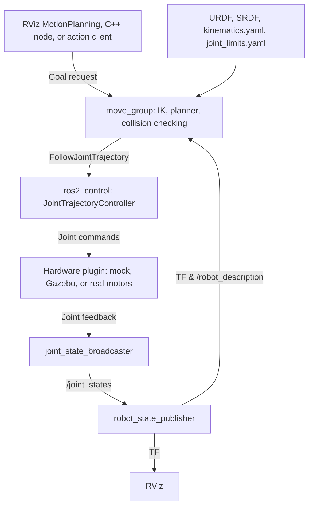

# MoveIt 2

**MoveIt 2 plans collision-free motion for articulated robots and hands execution off to `ros2_control`.** An application asks for a named pose, target joint angles, or a 3D end-effector pose; `move_group` solves inverse kinematics, checks collisions, builds a time-parameterized trajectory, and streams it to trajectory controllers. Because planning is decoupled from hardware drivers, the same planning stack runs with mock hardware, simulation, or physical actuators.

https://github.com/jinyongnan810/ros-practice/tree/main/9.moveit2

## 1. How MoveIt 2 fits together

Reference workspace: [demo.launch.py](https://github.com/jinyongnan810/ros-practice/blob/main/9.moveit2/src/robot_arm_moveit_config/launch/demo.launch.py), [six_axis_arm.srdf](https://github.com/jinyongnan810/ros-practice/blob/main/9.moveit2/src/robot_arm_moveit_config/config/six_axis_arm.srdf)



| Piece                       | Responsibility                                                                        | Where it is configured                             |
| --------------------------- | ------------------------------------------------------------------------------------- | -------------------------------------------------- |
| URDF / Xacro                | Physical links, joints, collision geometry, and joint limits                          | Robot description package                          |
| SRDF                        | Planning groups, named poses, end effectors, virtual joints, and disabled collisions  | `config/<robot>.srdf` in the MoveIt config package |
| Kinematics & limits YAML    | Inverse kinematics solver plugin, search timeout, and velocity/acceleration bounds    | `kinematics.yaml`, `joint_limits.yaml`             |
| `move_group`                | Maintains the planning scene, runs motion planners, and monitors trajectory execution | MoveIt config launch files                         |
| MoveIt controller manager   | Maps MoveIt planning groups to `FollowJointTrajectory` controller actions             | `moveit_controllers.yaml`                          |
| `ros2_control` controllers  | Execute timed trajectories (`JointTrajectoryController`) and publish `/joint_states`  | `ros2_controllers.yaml`                            |
| `MoveGroupInterface` / RViz | Client API or interactive UI used to set goals, plan trajectories, and trigger motion | Application C++/Python nodes or RViz plugin        |

**MoveIt 2 plans; `ros2_control` executes.** `move_group` never talks to motors directly and does not run a real-time control loop. It computes a `RobotTrajectory` and sends a `FollowJointTrajectory` action goal to `ros2_control`, which runs the hardware read → update → write cycle.

## 2. Model semantics with URDF and SRDF

Reference model and semantic config: [six_axis_arm.urdf.xacro](https://github.com/jinyongnan810/ros-practice/blob/main/9.moveit2/src/robot_arm_description/urdf/six_axis_arm.urdf.xacro), [six_axis_arm.srdf](https://github.com/jinyongnan810/ros-practice/blob/main/9.moveit2/src/robot_arm_moveit_config/config/six_axis_arm.srdf), [kinematics.yaml](https://github.com/jinyongnan810/ros-practice/blob/main/9.moveit2/src/robot_arm_moveit_config/config/kinematics.yaml), [joint_limits.yaml](https://github.com/jinyongnan810/ros-practice/blob/main/9.moveit2/src/robot_arm_moveit_config/config/joint_limits.yaml)

MoveIt splits robot modeling into two layers:

- **URDF / Xacro** defines physical structure: links, joint axes, range/effort limits, collision shapes, and inertia.
- **SRDF (Semantic Robot Description Format)** defines planning semantics on top of that URDF:

| SRDF element           | Purpose                                                                     | Example role                             |
| ---------------------- | --------------------------------------------------------------------------- | ---------------------------------------- |
| `<group>`              | Groups joints or links into an independent planning unit                    | `arm` (6-DOF chain), `gripper` (fingers) |
| `<group_state>`        | Saves named joint configurations for reuse                                  | `home`, `open`, `close`                  |
| `<virtual_joint>`      | Connects the robot's base link to a fixed or moving reference frame         | Fixed joint from `world` to `base_link`  |
| `<end_effector>`       | Associates a gripper group with its mounting link on the arm                | `gripper` attached to `tool0` on `arm`   |
| `<disable_collisions>` | Excludes adjacent or non-intersecting link pairs from self-collision checks | Allowed collision matrix entries         |

A `*_moveit_config` package is typically generated initially from a URDF with MoveIt Setup Assistant to produce the SRDF and baseline YAML files, then maintained directly in config files as the robot grows.

In the reference 6-axis arm, the SRDF defines an `arm` group, a `gripper` group, and named states such as `home` and `open`:

```xml
<group name="arm">
  <joint name="virtual_joint"/>
  <joint name="world_to_base"/>
  <joint name="joint_1"/>
  <!-- ... joint_2 .. joint_5 ... -->
  <joint name="joint_6"/>
  <joint name="flange_to_tool"/>
</group>

<group_state name="home" group="arm">
  <joint name="joint_1" value="0"/>
  <joint name="joint_2" value="-1.5707"/>
  <!-- ... remaining joints 0 ... -->
</group_state>

<end_effector name="gripper" parent_link="tool0" group="gripper" parent_group="arm"/>
```

Two companion YAML files govern how MoveIt turns goals into valid trajectories:

- **`kinematics.yaml`** selects the inverse kinematics (IK) solver per planning group—for example, `kdl_kinematics_plugin/KDLKinematicsPlugin` with `kinematics_solver_search_resolution` and `kinematics_solver_timeout`. IK converts a 3D end-effector pose into candidate joint angles.
- **`joint_limits.yaml`** sets or overrides maximum velocities and accelerations (plus default scaling factors) so MoveIt's time-parameterization stage assigns timestamps and velocities to geometric paths without violating hardware limits.

## 3. Connect planning to `ros2_control`

Reference controller setup: [moveit_controllers.yaml](https://github.com/jinyongnan810/ros-practice/blob/main/9.moveit2/src/robot_arm_moveit_config/config/moveit_controllers.yaml), [ros2_controllers.yaml](https://github.com/jinyongnan810/ros-practice/blob/main/9.moveit2/src/robot_arm_moveit_config/config/ros2_controllers.yaml), [six_axis_arm.ros2_control.xacro](https://github.com/jinyongnan810/ros-practice/blob/main/9.moveit2/src/robot_arm_moveit_config/config/six_axis_arm.ros2_control.xacro)

MoveIt executes trajectories through `FollowJointTrajectory` action servers. Two YAML files form the bridge: **MoveIt declares which action servers to call; `ros2_control` runs the controllers that serve them.** Controller names, action namespaces, and joint lists must match.

```yaml
# moveit_controllers.yaml (MoveIt side)
moveit_controller_manager: moveit_simple_controller_manager/MoveItSimpleControllerManager

moveit_simple_controller_manager:
  controller_names: [arm_controller, gripper_controller]
  arm_controller:
    type: FollowJointTrajectory
    joints: [joint_1, joint_2, joint_3, joint_4, joint_5, joint_6]
    action_ns: follow_joint_trajectory
    default: true
  gripper_controller:
    type: FollowJointTrajectory
    joints: [left_finger_joint]
    action_ns: follow_joint_trajectory
    default: true
```

```yaml
# ros2_controllers.yaml (ros2_control side)
controller_manager:
  ros__parameters:
    update_rate: 100
    arm_controller:
      type: joint_trajectory_controller/JointTrajectoryController
    gripper_controller:
      type: joint_trajectory_controller/JointTrajectoryController
    joint_state_broadcaster:
      type: joint_state_broadcaster/JointStateBroadcaster
```

Each `JointTrajectoryController` claims the `position` command interface on its joints and reads `position` / `velocity` state interfaces. `joint_state_broadcaster` publishes `/joint_states` so `move_group` always knows where the robot currently is.

**Do not assign command interfaces to `<mimic>` joints.** A parallel 2-finger gripper often drives one finger (`left_finger_joint`) and links the other (`right_finger_joint`) with `<mimic>` in URDF. Only the driven joint belongs in `gripper_controller` and `<command_interface>`; the mimic joint declares `<state_interface>`s only so RViz and MoveIt see both fingers move without attempting to command a passive joint.

## 4. Launch and swap hardware backends

Reference launch and hardware plugin: [demo.launch.py](https://github.com/jinyongnan810/ros-practice/blob/main/9.moveit2/src/robot_arm_moveit_config/launch/demo.launch.py), [six_axis_arm.ros2_control.xacro](https://github.com/jinyongnan810/ros-practice/blob/main/9.moveit2/src/robot_arm_moveit_config/config/six_axis_arm.ros2_control.xacro), [arm_hardware_interface.cpp](https://github.com/jinyongnan810/ros-practice/blob/main/9.moveit2/src/robot_arm_hardware/src/arm_hardware_interface.cpp)

On Ubuntu with ROS 2 Jazzy, install MoveIt 2 and CycloneDDS (often preferred as the RMW for MoveIt's parameter and action traffic):

```bash
sudo apt install ros-$ROS_DISTRO-rmw-cyclonedds-cpp ros-jazzy-moveit
export RMW_IMPLEMENTATION=rmw_cyclonedds_cpp
```

A standard MoveIt bringup (`MoveItConfigsBuilder` + `generate_demo_launch`) starts `robot_state_publisher`, `move_group`, `ros2_control_node`, controller spawners, and RViz with the MotionPlanning plugin.

Because MoveIt interacts only through `FollowJointTrajectory` and `/joint_states`, swapping hardware backends requires changing only the `<hardware><plugin>` in the robot's `.ros2_control.xacro`—for instance, toggling between `mock_components/GenericSystem` for dry-run planning and a real `hardware_interface::SystemInterface` plugin for physical servos.

In the reference workspace, a launch argument forwards `use_hardware` into Xacro so the same launch file runs both backends:

```bash
# Mock hardware (default): verify SRDF, IK, and planning without motors
ros2 launch robot_arm_moveit_config demo.launch.py

# Physical Dynamixel hardware: keep the same MoveIt config and action interfaces
ros2 launch robot_arm_moveit_config demo.launch.py \
  use_hardware:=true dynamixel_port:=/dev/ttyUSB0 baud_rate:=57600
```

When switching to real motors, ensure the hardware interface initializes commands to the measured joint positions during activation so the arm holds still on torque enable, and updates any mimic joint state values during `read()`.

## 5. Plan and execute with `MoveGroupInterface`

Reference C++ usage and action wrapper: [test_moveit.cpp](https://github.com/jinyongnan810/ros-practice/blob/main/9.moveit2/src/robot_arm_commander_cpp/src/test_moveit.cpp), [commander.cpp](https://github.com/jinyongnan810/ros-practice/blob/main/9.moveit2/src/robot_arm_commander_cpp/src/commander.cpp), [MoveArm.action](https://github.com/jinyongnan810/ros-practice/blob/main/9.moveit2/src/robot_arm_interface/action/MoveArm.action)

In C++, applications talk to `move_group` through `moveit::planning_interface::MoveGroupInterface`, one instance per planning group (e.g. `"arm"` and `"gripper"`).

### Keep an executor spinning

`MoveGroupInterface` subscribes to `/joint_states` and listens for planning/execution action feedback on the node you pass to it. **The node must be spinning while you plan and execute.** In a sequential script, spin a `SingleThreadedExecutor` on a background thread before creating or calling `MoveGroupInterface`; in a service or action server node, `rclcpp::spin(node)` serves the same purpose while callbacks run on worker threads.

### Standard planning workflow

Every MoveIt motion follows four steps: sync the start state to current feedback, set a target, plan, and execute.

| Target type  | API call                      | How MoveIt plans it                                                                  |
| ------------ | ----------------------------- | ------------------------------------------------------------------------------------ |
| Named pose   | `setNamedTarget("home")`      | Looks up joint values from `<group_state>` in SRDF and plans in joint space          |
| Joint target | `setJointValueTarget(joints)` | Plans directly in joint space to the given radians/meters without invoking IK        |
| Pose target  | `setPoseTarget(pose)`         | Solves IK for the end-effector link, then plans a collision-free path in joint space |

```cpp
arm.setStartStateToCurrentState();
arm.setPoseTarget(pose_goal);

MoveGroupInterface::Plan plan;
if (arm.plan(plan) == moveit::core::MoveItErrorCode::SUCCESS) {
  arm.execute(plan);
}
arm.clearPoseTargets();
```

Call `clearPoseTargets()` after pose planning if you reuse the same `MoveGroupInterface` for later named or joint goals.

### Joint-space pose goals vs. Cartesian paths

`setPoseTarget()` guarantees where the end effector arrives, **not** how it gets there—intermediate motion happens in joint space, so the tool tip typically follows an arc. When the tool must move in a straight line (such as inserting a part or approaching a grasp), use `computeCartesianPath()` instead:

```cpp
arm.setStartStateToCurrentState();
moveit_msgs::msg::RobotTrajectory trajectory;
const double fraction = arm.computeCartesianPath(waypoints, 0.01, trajectory);

if (fraction >= 0.9) {
  MoveGroupInterface::Plan cartesian_plan;
  cartesian_plan.trajectory = trajectory;
  arm.execute(cartesian_plan);
}
```

`computeCartesianPath` steps along the straight line between waypoints every `eef_step` meters (`0.01` m here) and solves IK at each step. Always check `fraction` before executing: if a straight line hits a joint limit, self-collision, or singularity partway through, `fraction` drops below `1.0`.

If other ROS nodes or CLI tools need to trigger motions without linking MoveIt headers directly, wrap `MoveGroupInterface` inside a ROS 2 action server (as `commander.cpp` does with `/move_arm` and `/control_gripper`), guarding each planning group with a mutex and forwarding action cancellation to `move_group.stop()`.

## 6. Troubleshoot planning and execution

Reference files to inspect: [moveit_controllers.yaml](https://github.com/jinyongnan810/ros-practice/blob/main/9.moveit2/src/robot_arm_moveit_config/config/moveit_controllers.yaml), [six_axis_arm.srdf](https://github.com/jinyongnan810/ros-practice/blob/main/9.moveit2/src/robot_arm_moveit_config/config/six_axis_arm.srdf), [commander.cpp](https://github.com/jinyongnan810/ros-practice/blob/main/9.moveit2/src/robot_arm_commander_cpp/src/commander.cpp)

| Symptom                                    | Check first                                                                                                  |
| ------------------------------------------ | ------------------------------------------------------------------------------------------------------------ |
| `MoveGroupInterface` stalls getting state  | Node has an active spinning executor and `joint_state_broadcaster` is publishing `/joint_states`             |
| Plan succeeds in RViz, execution aborts    | Controller names, `follow_joint_trajectory` namespaces, and joint lists match in MoveIt & `ros2_control`     |
| Pose goal fails planning immediately       | Pose is outside workspace reach, quaternion is zero/unnormalized, or `kinematics.yaml` timeout is too small  |
| Cartesian path returns low `fraction`      | Straight line crosses a joint limit, collision, or singularity; use `setPoseTarget` for large reorientations |
| Gripper controller fails to load or run    | Mimic joint mistakenly given a `command_interface` or listed inside `gripper_controller`                     |
| URDF, SRDF, or YAML changes have no effect | Package was not rebuilt and re-sourced before restarting `move_group`                                        |

Follow the planning pipeline end to end: URDF/SRDF model → `move_group` (IK + collision-free planning + time parameterization) → `FollowJointTrajectory` → `ros2_control` → `/joint_states`. Verify geometry and semantics in mock mode first, then swap only the hardware backend for simulation or physical actuators.
