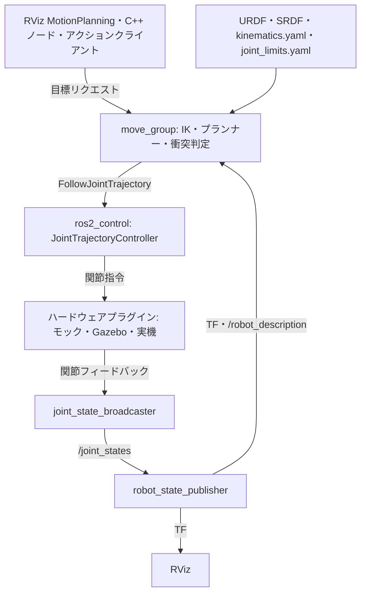

# MoveIt 2

**MoveIt 2 は、多関節ロボットの衝突しない軌道を計画し、実行を `ros2_control` に渡すフレームワークです。** アプリが名前付き姿勢・関節角度・手先の 3D 姿勢を指定すると、`move_group` が逆運動学と衝突回避を解き、時刻付きの軌道を生成してコントローラーへ送ります。計画層とハードウェア層が分離されているため、同じ計画構成のままモック・シミュレーション・実機を切り替えられます。

https://github.com/jinyongnan810/ros-practice/tree/main/9.moveit2

## 1. MoveIt 2 の全体像

参考ワークスペース: [demo.launch.py](https://github.com/jinyongnan810/ros-practice/blob/main/9.moveit2/src/robot_arm_moveit_config/launch/demo.launch.py), [six_axis_arm.srdf](https://github.com/jinyongnan810/ros-practice/blob/main/9.moveit2/src/robot_arm_moveit_config/config/six_axis_arm.srdf)



| 要素                          | 役割                                                                     | 設定場所                                         |
| ----------------------------- | ------------------------------------------------------------------------ | ------------------------------------------------ |
| URDF / Xacro                  | 物理リンク、関節、衝突形状、関節制限を定義する                           | ロボット記述パッケージ                           |
| SRDF                          | 計画グループ、名前付き姿勢、エンドエフェクタ、仮想関節、自己衝突除外     | MoveIt 設定パッケージの `config/<robot>.srdf`    |
| Kinematics / Limits YAML      | 逆運動学ソルバー、探索タイムアウト、速度・加速度上限                     | `kinematics.yaml`、`joint_limits.yaml`           |
| `move_group`                  | プランニングシーンの保持、軌道計画、実行監視を担う中核ノード             | MoveIt 設定の launch ファイル                    |
| MoveIt controller manager     | 計画グループと `FollowJointTrajectory` アクションを対応付ける            | `moveit_controllers.yaml`                        |
| `ros2_control` コントローラー | 時刻付き軌道の追従（`JointTrajectoryController`）と `/joint_states` 配信 | `ros2_controllers.yaml`                          |
| `MoveGroupInterface` / RViz   | 目標の設定、軌道計画、実行指示を行うクライアント API / GUI               | アプリの C++/Python ノードまたは RViz プラグイン |

**MoveIt 2 が計画し、`ros2_control` が実行します。** `move_group` 自身はモーターと直接通信せず、リアルタイム制御ループも持ちません。生成した `RobotTrajectory` を `FollowJointTrajectory` アクションとして `ros2_control` に渡し、コントローラー側がハードウェアに対する read → update → write を実行します。

## 2. URDF と SRDF でロボットと意味情報を定義する

参考モデルと意味設定: [six_axis_arm.urdf.xacro](https://github.com/jinyongnan810/ros-practice/blob/main/9.moveit2/src/robot_arm_description/urdf/six_axis_arm.urdf.xacro), [six_axis_arm.srdf](https://github.com/jinyongnan810/ros-practice/blob/main/9.moveit2/src/robot_arm_moveit_config/config/six_axis_arm.srdf), [kinematics.yaml](https://github.com/jinyongnan810/ros-practice/blob/main/9.moveit2/src/robot_arm_moveit_config/config/kinematics.yaml), [joint_limits.yaml](https://github.com/jinyongnan810/ros-practice/blob/main/9.moveit2/src/robot_arm_moveit_config/config/joint_limits.yaml)

MoveIt ではロボット記述を 2 つの層に分けて扱います。

- **URDF / Xacro** は物理構造（リンク、関節軸、可動域・トルク制限、衝突ジオメトリ、慣性）を記述します。
- **SRDF（Semantic Robot Description Format）** はその上に計画用の意味情報を追加します。

| SRDF の要素            | 役割                                                       | 典型的な用途                               |
| ---------------------- | ---------------------------------------------------------- | ------------------------------------------ |
| `<group>`              | 同時に計画する関節やリンクのまとまりを定義する             | `arm`（6 軸チェーン）、`gripper`（指先）   |
| `<group_state>`        | 再利用する関節角度のプリセット姿勢に名前を付ける           | `home`、`open`、`close`                    |
| `<virtual_joint>`      | ロボットのベースリンクと外部基準フレームを接続する         | `world` と `base_link` の固定接続          |
| `<end_effector>`       | グリッパー等のグループを親リンクと親グループに紐づける     | `arm` の `tool0` に `gripper` を取り付ける |
| `<disable_collisions>` | 隣接リンクや接触し得ないペアを自己衝突チェックから除外する | 許容衝突マトリクス（ACM）の定義            |

`*_moveit_config` パッケージは通常、最初に MoveIt Setup Assistant を使って URDF から SRDF と基本 YAML を生成し、その後は構成に合わせて設定ファイルを直接保守します。

参考例の 6 軸アームでは、SRDF に `arm` グループ、`gripper` グループ、`home` などの名前付き姿勢を次のように定義しています。

```xml
<group name="arm">
  <joint name="virtual_joint"/>
  <joint name="world_to_base"/>
  <joint name="joint_1"/>
  <!-- ... joint_2 .. joint_5 ... -->
  <joint name="joint_6"/>
  <joint name="flange_to_tool"/>
</group>

<group_state name="home" group="arm">
  <joint name="joint_1" value="0"/>
  <joint name="joint_2" value="-1.5707"/>
  <!-- ... 残りの関節は 0 ... -->
</group_state>

<end_effector name="gripper" parent_link="tool0" group="gripper" parent_group="arm"/>
```

計画を物理的に実行可能な軌道へ変換するため、次の 2 つの YAML を併用します。

- **`kinematics.yaml`**：グループごとに逆運動学（IK）ソルバー（例：`kdl_kinematics_plugin/KDLKinematicsPlugin`）と探索解像度・タイムアウトを指定します。手先の 3D 姿勢から関節角を求めるために使われます。
- **`joint_limits.yaml`**：各関節の最大速度・最大加速度とスケーリング係数を設定します。MoveIt のプランナーが幾何的な経路を作った後、時刻パラメーター化によって速度制限を超えない時刻付き軌道を割り当てます。

## 3. MoveIt 2 と `ros2_control` を接続する

参考コントローラー設定: [moveit_controllers.yaml](https://github.com/jinyongnan810/ros-practice/blob/main/9.moveit2/src/robot_arm_moveit_config/config/moveit_controllers.yaml), [ros2_controllers.yaml](https://github.com/jinyongnan810/ros-practice/blob/main/9.moveit2/src/robot_arm_moveit_config/config/ros2_controllers.yaml), [six_axis_arm.ros2_control.xacro](https://github.com/jinyongnan810/ros-practice/blob/main/9.moveit2/src/robot_arm_moveit_config/config/six_axis_arm.ros2_control.xacro)

MoveIt は `FollowJointTrajectory` アクションを通じて軌道を実行します。**MoveIt 側は「どのアクションを呼ぶか」、`ros2_control` 側は「どのコントローラーで受けるか」**をそれぞれの YAML に書き、コントローラー名・アクション名前空間・関節リストを一致させます。

```yaml
# moveit_controllers.yaml (MoveIt 側)
moveit_controller_manager: moveit_simple_controller_manager/MoveItSimpleControllerManager

moveit_simple_controller_manager:
  controller_names: [arm_controller, gripper_controller]
  arm_controller:
    type: FollowJointTrajectory
    joints: [joint_1, joint_2, joint_3, joint_4, joint_5, joint_6]
    action_ns: follow_joint_trajectory
    default: true
  gripper_controller:
    type: FollowJointTrajectory
    joints: [left_finger_joint]
    action_ns: follow_joint_trajectory
    default: true
```

```yaml
# ros2_controllers.yaml (ros2_control 側)
controller_manager:
  ros__parameters:
    update_rate: 100
    arm_controller:
      type: joint_trajectory_controller/JointTrajectoryController
    gripper_controller:
      type: joint_trajectory_controller/JointTrajectoryController
    joint_state_broadcaster:
      type: joint_state_broadcaster/JointStateBroadcaster
```

各 `JointTrajectoryController` は対象関節の `position` 指令インターフェースを占有し、`position` / `velocity` の状態インターフェースを読み取ります。`joint_state_broadcaster` が `/joint_states` を配信することで、`move_group` は常に最新のロボット姿勢を把握できます。

**`<mimic>` 関節には指令インターフェースを付けません。** 平行グリッパーのように片側の指（`left_finger_joint`）だけを駆動し、もう片方（`right_finger_joint`）を URDF の `<mimic>` で追従させる構成では、駆動関節だけを `gripper_controller` と `<command_interface>` に登録します。従動関節には `<state_interface>` だけを持たせ、受動関節へ指令を出さずに RViz や MoveIt へ両指の状態を反映させます。

## 4. モックと実機を切り替えて起動する

参考 launch とハードウェア実装: [demo.launch.py](https://github.com/jinyongnan810/ros-practice/blob/main/9.moveit2/src/robot_arm_moveit_config/launch/demo.launch.py), [six_axis_arm.ros2_control.xacro](https://github.com/jinyongnan810/ros-practice/blob/main/9.moveit2/src/robot_arm_moveit_config/config/six_axis_arm.ros2_control.xacro), [arm_hardware_interface.cpp](https://github.com/jinyongnan810/ros-practice/blob/main/9.moveit2/src/robot_arm_hardware/src/arm_hardware_interface.cpp)

Ubuntu の ROS 2 Jazzy 環境では、MoveIt 2 と CycloneDDS（MoveIt のパラメーターやアクション通信で推奨される RMW）をインストールします。

```bash
sudo apt install ros-$ROS_DISTRO-rmw-cyclonedds-cpp ros-jazzy-moveit
export RMW_IMPLEMENTATION=rmw_cyclonedds_cpp
```

標準的な MoveIt の起動（`MoveItConfigsBuilder` と `generate_demo_launch`）では、`robot_state_publisher`、`move_group`、`ros2_control_node`、コントローラーの spawner、MotionPlanning プラグイン付きの RViz がまとめて立ち上がります。

MoveIt 側の依存は `FollowJointTrajectory` と `/joint_states` だけなので、`.ros2_control.xacro` の `<hardware><plugin>` を差し替えるだけで、計画設定やアプリコードを変えずに `mock_components/GenericSystem`・Gazebo・実機ドライバーを切り替えられます。

参考例では、`use_hardware` 引数を launch から Xacro に渡してバックエンドを切り替えています（パッケージ名・launch 名は参考例のものです）。

```bash
# モックハードウェア（デフォルト）：実機なしで SRDF・IK・計画を確認
ros2 launch robot_arm_moveit_config demo.launch.py

# 実機 Dynamixel に切り替え：MoveIt 設定やアクションはそのままで起動
ros2 launch robot_arm_moveit_config demo.launch.py \
  use_hardware:=true dynamixel_port:=/dev/ttyUSB0 baud_rate:=57600
```

実機へ切り替える際は、有効化（`on_activate`）時に現在位置で指令値を初期化してトルクオン時の急動を防ぎ、`read()` で mimic 関節の状態も更新しておくことが重要です。

## 5. `MoveGroupInterface` で計画と実行を行う

参考 C++ 実装とアクション定義: [test_moveit.cpp](https://github.com/jinyongnan810/ros-practice/blob/main/9.moveit2/src/robot_arm_commander_cpp/src/test_moveit.cpp), [commander.cpp](https://github.com/jinyongnan810/ros-practice/blob/main/9.moveit2/src/robot_arm_commander_cpp/src/commander.cpp), [MoveArm.action](https://github.com/jinyongnan810/ros-practice/blob/main/9.moveit2/src/robot_arm_interface/action/MoveArm.action)

C++ から `move_group` を操作するには、計画グループごとに `moveit::planning_interface::MoveGroupInterface`（`"arm"` や `"gripper"` など）を生成して使います。

### executor を spin させておく

`MoveGroupInterface` は渡されたノード上で `/joint_states` の購読やアクションのフィードバック受信を行います。**計画と実行の間、ノードが spin している必要があります。** 逐次実行スクリプトでは別スレッドで `SingleThreadedExecutor` を spin させ、アクションサーバーのような常駐ノードでは `rclcpp::spin(node)` を回しながらワーカースレッドで計画・実行を処理します。

### 基本の計画フロー

どの目標指定でも、現在状態を始点に合わせる → 目標を設定 → 計画 → 実行、という 4 ステップで動かします。

| 目標の種類   | API                           | 計画の仕組み                                                     |
| ------------ | ----------------------------- | ---------------------------------------------------------------- |
| 名前付き姿勢 | `setNamedTarget("home")`      | SRDF の `<group_state>` から関節角を引き、関節空間で計画する     |
| 関節目標     | `setJointValueTarget(joints)` | IK を使わず、指定した関節角（rad / m）へ直接関節空間で計画する   |
| 手先姿勢目標 | `setPoseTarget(pose)`         | エンドエフェクタの IK を解き、関節空間で衝突のない経路を計画する |

```cpp
arm.setStartStateToCurrentState();
arm.setPoseTarget(pose_goal);

MoveGroupInterface::Plan plan;
if (arm.plan(plan) == moveit::core::MoveItErrorCode::SUCCESS) {
  arm.execute(plan);
}
arm.clearPoseTargets();
```

同じ `MoveGroupInterface` インスタンスで引き続き名前付き姿勢や関節目標を計画する場合は、実行後に `clearPoseTargets()` を呼んで姿勢目標をクリアします。

### 関節空間の姿勢計画と直交軌道（Cartesian Path）

`setPoseTarget()` は目標姿勢への到達を保証しますが、**手先の移動経路は直線になりません。** 関節空間で計画するため、手先軌道は弧を描きます。挿入作業や把持アプローチのように手先を直線で動かしたい場合は `computeCartesianPath()` を使います。

```cpp
arm.setStartStateToCurrentState();
moveit_msgs::msg::RobotTrajectory trajectory;
const double fraction = arm.computeCartesianPath(waypoints, 0.01, trajectory);

if (fraction >= 0.9) {
  MoveGroupInterface::Plan cartesian_plan;
  cartesian_plan.trajectory = trajectory;
  arm.execute(cartesian_plan);
}
```

`computeCartesianPath` はウェイポイント間の直線を `eef_step`（ここでは `0.01` m）ごとに区切って IK を解きます。直線経路の途中で関節制限・自己衝突・特異点に当たると達成率 `fraction` が `1.0` を下回るため、実行前に必ず閾値を確認します。

MoveIt の C++ ヘッダーに依存せず外部ノードや CLI からアームを動かしたい場合は、参考例の `commander.cpp` のように `MoveGroupInterface` を ROS 2 アクション（`/move_arm`、`/control_gripper`）で包み、グループごとの排他制御と `stop()` によるキャンセル処理を実装します。

## 6. 計画と実行を切り分けて調べる

確認対象の設定と実装: [moveit_controllers.yaml](https://github.com/jinyongnan810/ros-practice/blob/main/9.moveit2/src/robot_arm_moveit_config/config/moveit_controllers.yaml), [six_axis_arm.srdf](https://github.com/jinyongnan810/ros-practice/blob/main/9.moveit2/src/robot_arm_moveit_config/config/six_axis_arm.srdf), [commander.cpp](https://github.com/jinyongnan810/ros-practice/blob/main/9.moveit2/src/robot_arm_commander_cpp/src/commander.cpp)

| 症状                                          | 最初に確認すること                                                                                               |
| --------------------------------------------- | ---------------------------------------------------------------------------------------------------------------- |
| `MoveGroupInterface` が現在状態の取得で止まる | ノードに spin 中の executor があるか、`joint_state_broadcaster` が `/joint_states` を出しているか                |
| RViz で計画は通るが実行で失敗する             | `moveit_controllers.yaml` と `ros2_controllers.yaml` のコントローラー名・`action_ns`・関節リストが一致しているか |
| 姿勢目標の計画がすぐ失敗する                  | 目標が到達範囲内か、クォータニオンが正規化されているか、`kinematics.yaml` のタイムアウトが短すぎないか           |
| Cartesian Path の `fraction` が低い           | 直線経路が関節制限・自己衝突・特異点に触れていないか（大きな姿勢変更は `setPoseTarget` を使う）                  |
| グリッパーのコントローラーが起動しない        | 受動の `<mimic>` 関節に `command_interface` やコントローラーへの登録が残っていないか                             |
| URDF・SRDF・YAML の変更が反映されない         | パッケージの再ビルドと `setup.bash` の再読み込みを行い、`move_group` を再起動したか                              |

URDF/SRDF モデル → `move_group`（IK・衝突回避・時刻パラメーター化）→ `FollowJointTrajectory` → `ros2_control` → `/joint_states` の経路に沿って切り分けます。まずはモックハードウェアで定義と計画を確認し、その後に下層のバックエンドだけをシミュレーションや実機へ切り替えます。
