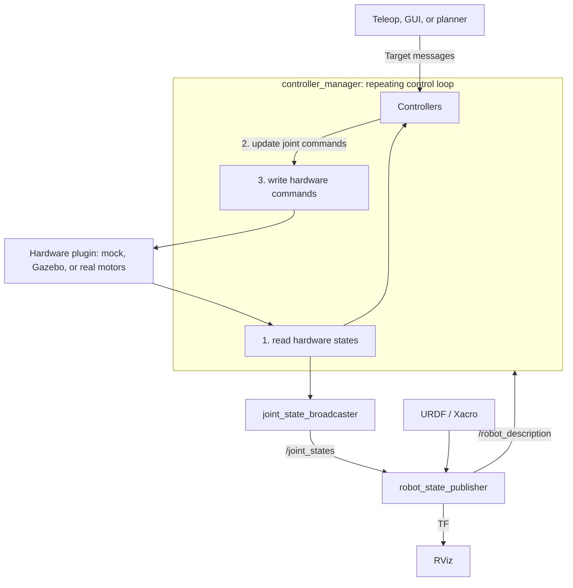

# ros2_control

**ros2_control connects robot controllers to interchangeable hardware backends.** An application sends a target, a controller turns it into joint commands, and a hardware plugin reads feedback and writes commands to motors. With the same joint interfaces, you can develop with mock hardware and later use physical actuators.

https://github.com/jinyongnan810/ros-practice/tree/main/8.ros2_control

## 1. How the pieces fit together

Stack startup: [robot.launch.xml](https://github.com/jinyongnan810/ros-practice/blob/main/8.ros2_control/src/robot_bringup/launch/robot.launch.xml)



| Piece                        | Responsibility                                                                     | Where it is configured                              |
| ---------------------------- | ---------------------------------------------------------------------------------- | --------------------------------------------------- |
| URDF / Xacro                 | Links, joints, and the command/state interfaces exposed to controllers             | URDF / Xacro files                                  |
| Hardware plugin              | Convert motor feedback into joint states and joint commands into device operations | `<hardware><plugin>` and its implementation package |
| Resource manager             | Load hardware plugins and manage their interfaces                                  | Inside the controller manager                       |
| Controller manager           | Manage controller lifecycles and execute the read → update → write loop            | `ros2_control_node` plus controller YAML            |
| Controller                   | Turn an application target into joint commands                                     | Controller type and parameters in YAML              |
| Joint state broadcaster      | Publish available joint feedback as `/joint_states`                                | Spawned alongside controllers                       |
| Robot state publisher / RViz | Turn joint states into TF / display the result                                     | Launch files and RViz configuration                 |

**A command is a request; a state is feedback.** For a wheel, `velocity` commands are in rad/s and `position` feedback is in radians. An arm joint may accept a `position` command while reporting both position and velocity. Controllers claim command interfaces; two ordinary controllers cannot simultaneously command the same interface.

RViz displays the reported state. Seeing a moving robot in RViz does not prove that a physical motor moved.

## 2. Choose the hardware backend

Backend selection: [simple_car.ros2_control.xacro](https://github.com/jinyongnan810/ros-practice/blob/main/8.ros2_control/src/robot_description/urdf/simple_car.ros2_control.xacro)

| Backend                           | What happens                                      | Use it for                                                                            |
| --------------------------------- | ------------------------------------------------- | ------------------------------------------------------------------------------------- |
| `mock_components/GenericSystem`   | Ideal feedback derived from commands              | Checking interfaces, controllers, launch files, and application topics without motors |
| `gz_ros2_control/GazeboSimSystem` | Commands and feedback pass through Gazebo physics | Testing contact, gravity, friction, and simulated sensors                             |
| A real hardware plugin            | Sends device commands and reads measured feedback | Operating physical motors and validating communication, calibration, and response     |

The reusable contract is the **joint names and command/state interfaces**. Keep that contract when swapping backends, and the application topics and controller choices can stay the same. Hardware parameters and simulation tuning still differ.

Mock hardware has no collisions or realistic actuator dynamics. With `calculate_dynamics: true`, GenericSystem can integrate velocity commands into position and derive related states. That is useful for testing wheel odometry wiring, but says nothing about traction or motor performance. See the [Jazzy mock component documentation](https://control.ros.org/jazzy/doc/ros2_control/hardware_interface/doc/mock_components_userdoc.html).

## 3. Declare the joint interfaces and controllers

Two configurations work together: **URDF describes the available interfaces; YAML selects the controllers that use them.** Joint names must agree in both files.

### URDF / Xacro: expose the hardware

Joint interface declarations: [simple_car.ros2_control.xacro](https://github.com/jinyongnan810/ros-practice/blob/main/8.ros2_control/src/robot_description/urdf/simple_car.ros2_control.xacro)

For an arm with two revolute joints, add the following block inside the robot's Xacro. The normal URDF links and joints must already define `arm_joint_1` and `arm_joint_2`; this block adds their control interfaces:

```xml
<ros2_control name="robotic_arm" type="system">
  <hardware>
    <plugin>mock_components/GenericSystem</plugin>
  </hardware>
  <joint name="arm_joint_1">
    <command_interface name="position" />
    <state_interface name="position">
      <param name="initial_value">0.0</param>
    </state_interface>
    <state_interface name="velocity" />
  </joint>
  <joint name="arm_joint_2">
    <command_interface name="position" />
    <state_interface name="position">
      <param name="initial_value">0.0</param>
    </state_interface>
    <state_interface name="velocity" />
  </joint>
</ros2_control>
```

`type="system"` groups multiple joints behind one hardware component. For example, one component can own the communication bus for an entire arm. A robot can also have separate components for its base, arm, and gripper.

### Controller YAML: select how to command the joints

Controller types and parameters: [robot_controllers.yaml](https://github.com/jinyongnan810/ros-practice/blob/main/8.ros2_control/src/robot_bringup/config/robot_controllers.yaml)

The arm-related excerpt from `robot_controllers.yaml` looks like this:

```yaml
controller_manager:
  ros__parameters:
    update_rate: 50
    joint_state_broadcaster:
      type: joint_state_broadcaster/JointStateBroadcaster
    arm_controller:
      type: position_controllers/JointGroupPositionController

arm_controller:
  ros__parameters:
    joints: [arm_joint_1, arm_joint_2]
```

The manager block registers controller names and plugin types. The separate `arm_controller` block supplies its parameters. This controller claims each joint's `position` command interface; the broadcaster publishes joint feedback.

At 50 Hz, the requested control period is 20 ms. Each cycle reads feedback, updates controllers, and writes commands. A controller must be loaded, configured, and activated before it runs; the spawner handles these transitions. See the [Jazzy controller manager documentation](https://control.ros.org/jazzy/doc/ros2_control/controller_manager/doc/userdoc.html).

## 4. Bring up mock hardware

XML launch configuration: [robot.launch.xml](https://github.com/jinyongnan810/ros-practice/blob/main/8.ros2_control/src/robot_bringup/launch/robot.launch.xml)

On Ubuntu with ROS 2 Jazzy installed, install the control packages:

```bash
sudo apt install ros-jazzy-ros2-control ros-jazzy-ros2-controllers \
  ros-jazzy-robot-state-publisher ros-jazzy-xacro
```

A typical bringup starts the robot description publisher, controller manager, and controller spawners. This excerpt from `robot.launch.xml` shows those roles; RViz and the optional command GUI are omitted:

```xml
<launch>
  <arg name="model"
       default="$(find-pkg-share robot_description)/urdf/simple_car.urdf.xacro" />
  <arg name="controller_config"
       default="$(find-pkg-share robot_bringup)/config/robot_controllers.yaml" />

  <node pkg="robot_state_publisher" exec="robot_state_publisher" output="screen">
    <param name="robot_description"
           value="$(command 'xacro $(var model)')" type="str" />
  </node>

  <node pkg="controller_manager" exec="ros2_control_node" output="both">
    <param from="$(var controller_config)" />
    <param name="robot_description"
           value="$(command 'xacro $(var model)')" type="str" />
  </node>

  <node pkg="controller_manager" exec="spawner" args="joint_state_broadcaster" />
  <node pkg="controller_manager" exec="spawner" args="diff_drive_controller" />
  <node pkg="controller_manager" exec="spawner" args="wheel_joint_controller" />
  <node pkg="controller_manager" exec="spawner" args="arm_controller" />
</launch>
```

`model` selects the Xacro, and `controller_config` selects the YAML. `$(command ...)` expands the Xacro into a URDF string; `type="str"` preserves it as a string parameter. `<param from="..." />` loads the controller configuration, and each spawner loads, configures, and activates its controller.

The full YAML includes the base, rotating platform, and arm controllers. The arm-only excerpt above explains the pattern; use the full configuration when starting all four spawners.

After building and sourcing the robot packages, launch the stack from the workspace root:

```bash
source /opt/ros/jazzy/setup.bash
source install/setup.bash
ros2 launch robot_bringup robot.launch.xml
```

These package and launch names come from the reference example. For another robot, use its description, controller YAML, and bringup package. Restart the stack after changing the hardware description.

In another terminal with the same environment sourced, inspect the result:

```bash
ros2 control list_hardware_components
ros2 control list_hardware_interfaces
ros2 control list_controllers
ros2 topic echo /joint_states
```

Expect the hardware components and spawned controllers to be active. The arm's position command interfaces should be available and claimed by `arm_controller`.

## 5. Send commands and read feedback

### Position control for an arm

Position controller settings and command publishing: [robot_controllers.yaml](https://github.com/jinyongnan810/ros-practice/blob/main/8.ros2_control/src/robot_bringup/config/robot_controllers.yaml), [position_command_gui.py](https://github.com/jinyongnan810/ros-practice/blob/main/8.ros2_control/src/robot_bringup/scripts/position_command_gui.py)

```bash
# [arm_joint_1, arm_joint_2], in radians
ros2 topic pub --once /arm_controller/commands \
  std_msgs/msg/Float64MultiArray '{data: [0.5, -0.5]}'
```

The array order follows the YAML `joints` list. With mock hardware, `/joint_states` reflects the requested positions. With real hardware, it should reflect measured positions returned by the driver.

`JointGroupPositionController` forwards position targets. Motion tracking is handled by the hardware backend or actuator; this controller does not generate a timed trajectory or implement PID itself. For coordinated motion with timestamps and interpolation, use `joint_trajectory_controller` with interfaces and limits appropriate to the robot. See the [position controller documentation](https://control.ros.org/jazzy/doc/ros2_controllers/position_controllers/doc/userdoc.html).

A command GUI should publish targets to the controller and display feedback from `/joint_states`. `joint_state_publisher_gui` is useful for previewing a URDF independently; it does not command ros2_control hardware.

### Velocity control for a mobile base

Wheel mapping, geometry, and command timeout: [robot_controllers.yaml](https://github.com/jinyongnan810/ros-practice/blob/main/8.ros2_control/src/robot_bringup/config/robot_controllers.yaml)

For a differential drive base, expose `velocity` command interfaces and `position` / `velocity` state interfaces on the wheel joints. Register `diff_drive_controller/DiffDriveController` in the manager YAML and configure it with the wheel joint names and dimensions:

```yaml
# Add under controller_manager.ros__parameters:
# diff_drive_controller:
#   type: diff_drive_controller/DiffDriveController

diff_drive_controller:
  ros__parameters:
    left_wheel_names: [front_left_wheel_joint, rear_left_wheel_joint]
    right_wheel_names: [front_right_wheel_joint, rear_right_wheel_joint]
    wheel_separation: 0.45
    wheel_radius: 0.1
    cmd_vel_timeout: 0.5
    odom_frame_id: odom
    base_frame_id: base_link
    enable_odom_tf: true
```

Use the actual wheel dimensions in meters. Spawn the controller, then send stamped keyboard commands in another terminal:

```bash
ros2 run controller_manager spawner diff_drive_controller
ros2 run teleop_twist_keyboard teleop_twist_keyboard --ros-args \
  -r /cmd_vel:=/diff_drive_controller/cmd_vel \
  -p stamped:=true -p frame_id:=base_link
```

This requires `teleop_twist_keyboard` to be installed. Jazzy's controller accepts `TwistStamped`; it converts forward speed and yaw rate into wheel velocities. The example timeout stops commanded motion after 0.5 seconds without fresh commands.

The controller publishes `/diff_drive_controller/odom` and, with this configuration, `odom → base_link` TF. Encoders measure wheel rotation, so wheel odometry can still drift when wheels slip. See the [differential drive controller documentation](https://control.ros.org/jazzy/doc/ros2_controllers/diff_drive_controller/doc/userdoc.html).

## 6. Switch from mock to real hardware

Hardware plugin selection and motor IDs: [simple_car.ros2_control.xacro](https://github.com/jinyongnan810/ros-practice/blob/main/8.ros2_control/src/robot_description/urdf/simple_car.ros2_control.xacro)

Keep the joint names, command/state interfaces, controller YAML, and application topics. Replace the mock plugin with a driver for your robot and supply its connection parameters.

For example, the arm's real hardware block is:

```xml
<hardware>
  <plugin>robot_hardware/ArmJointsHardwareInterface</plugin>
  <param name="port_name">/dev/ttyUSB2</param>
  <param name="baud_rate">57600</param>
</hardware>
```

This replaces the `mock_components/GenericSystem` block in Xacro. The joint declarations retain their position command and position/velocity state interfaces. The reference driver maps joints to motors through each joint's `dxl_id` parameter:

```xml
<joint name="arm_joint_1">
  <param name="dxl_id">15</param>
  <command_interface name="position" />
  <state_interface name="position" />
  <state_interface name="velocity" />
</joint>
```

Plugin names and connection parameters depend on the hardware driver. Here, `port_name`, `baud_rate`, and `dxl_id` belong to the example's Dynamixel driver; adapt them to the actual devices. Rebuild C++ changes, source the installed packages, and relaunch to load the selected backend.

### What the driver does

Driver lifecycle, read/write, and plugin registration: [position_hardware_interface.cpp](https://github.com/jinyongnan810/ros-practice/blob/main/8.ros2_control/src/robot_hardware/src/position_hardware_interface.cpp), [robot_hardware.xml](https://github.com/jinyongnan810/ros-practice/blob/main/8.ros2_control/src/robot_hardware/robot_hardware.xml)

| Implementation          | Code and role                                                                                                                                                                                                                                                                                                                                                                                                                   |
| ----------------------- | ------------------------------------------------------------------------------------------------------------------------------------------------------------------------------------------------------------------------------------------------------------------------------------------------------------------------------------------------------------------------------------------------------------------------------- |
| Motor driver            | [xl330_driver.hpp](https://github.com/jinyongnan810/ros-practice/blob/main/8.ros2_control/src/robot_hardware/include/robot_hardware/xl330_driver.hpp): Dynamixel SDK communication, operating modes, torque, and position/velocity reads and writes                                                                                                                                                                             |
| Arm hardware interface  | [arm_joints_hardware_interface.cpp](https://github.com/jinyongnan810/ros-practice/blob/main/8.ros2_control/src/robot_hardware/src/arm_joints_hardware_interface.cpp): joint-to-motor mapping and plugin export; shared lifecycle and read/write logic lives in [position_hardware_interface.cpp](https://github.com/jinyongnan810/ros-practice/blob/main/8.ros2_control/src/robot_hardware/src/position_hardware_interface.cpp) |
| Base hardware interface | [base_link_hardware_interface.cpp](https://github.com/jinyongnan810/ros-practice/blob/main/8.ros2_control/src/robot_hardware/src/base_link_hardware_interface.cpp): connects drive-wheel velocity commands and joint states to ros2_control                                                                                                                                                                                     |

| Stage           | Typical work                                                                  |
| --------------- | ----------------------------------------------------------------------------- |
| `on_init`       | Validate interfaces and parse configuration                                   |
| `on_configure`  | Connect to devices and obtain initial feedback                                |
| `on_activate`   | Initialize commands, such as holding measured position, then enable actuators |
| `read`          | Convert encoder or sensor measurements into joint states                      |
| `write`         | Convert joint commands into device commands and send them                     |
| `on_deactivate` | Stop or disable actuators as appropriate for the mechanism                    |

The driver handles encoder units, offsets, direction, gearing, and communication errors. For a shared motor bus, one system plugin can coordinate access to all attached actuators. Real feedback comes from measurements; integrating command velocity produces an estimate rather than measured motion.

For a custom driver, implement `hardware_interface::SystemInterface`, export it through pluginlib, and install its plugin description XML. Build and source the driver package before selecting it. See the [hardware component implementation guide](https://control.ros.org/jazzy/doc/ros2_control/hardware_interface/doc/writing_new_hardware_component.html).

After switching, verify the selected plugin and measured feedback, then test small commands. Check units, direction, joint limits, and stop behavior. The controller interface stays the same; the real actuator's response determines the resulting motion.

## 7. Use Gazebo when you need physics

Gazebo plugin, launch, and topic bridge: [simple_car.gazebo.xacro](https://github.com/jinyongnan810/ros-practice/blob/main/8.ros2_control/src/robot_description/urdf/simple_car.gazebo.xacro), [gazebo.launch.xml](https://github.com/jinyongnan810/ros-practice/blob/main/8.ros2_control/src/robot_bringup/launch/gazebo.launch.xml), [gazebo_bridge.yaml](https://github.com/jinyongnan810/ros-practice/blob/main/8.ros2_control/src/robot_bringup/config/gazebo_bridge.yaml)

Gazebo adds dynamics, collisions, and simulated sensors while retaining the controller interfaces. On Jazzy / Harmonic, install:

```bash
sudo apt install ros-jazzy-ros-gz-sim ros-jazzy-ros-gz-bridge ros-jazzy-gz-ros2-control
```

Use `gz_ros2_control/GazeboSimSystem` as the hardware plugin and add the Gazebo integration plugin to the robot model. Supply the controller YAML to that plugin and spawn the model in Gazebo.

The integration plugin creates the controller manager **inside Gazebo**. Spawn controllers against that manager instead of also running a standalone `ros2_control_node` for the same robot. See the [Gazebo integration documentation](https://control.ros.org/jazzy/doc/gz_ros2_control/doc/index.html) for model and launch configuration.

Joint states, controller commands, and odometry are ROS topics provided by ros2_control. Bridge Gazebo-native topics such as the clock and camera as needed, and enable `use_sim_time` on ROS nodes using simulation time. Keep one controller responsible for each joint command interface.

## 8. Troubleshoot the control path

Configuration and feedback implementation to inspect: [robot_controllers.yaml](https://github.com/jinyongnan810/ros-practice/blob/main/8.ros2_control/src/robot_bringup/config/robot_controllers.yaml), [position_hardware_interface.cpp](https://github.com/jinyongnan810/ros-practice/blob/main/8.ros2_control/src/robot_hardware/src/position_hardware_interface.cpp)

| Symptom                           | Check first                                                                         |
| --------------------------------- | ----------------------------------------------------------------------------------- |
| Spawner waits forever             | Manager startup, robot description, namespace, and manager path                     |
| Controller will not activate      | Required joint names and interfaces, hardware state, and competing interface claims |
| Base ignores commands             | Controller state, topic name, `TwistStamped` type, timestamps, and timeout          |
| Wrong joint moves                 | YAML joint order, actuator mapping, joint axes, and direction conversion            |
| Feedback does not change          | Selected backend, device communication, and the driver's `read()` implementation    |
| No moving TF in RViz              | `/joint_states`, broadcaster, and robot state publisher                             |
| Odometry scale or turns are wrong | Wheel radius, separation, direction, and encoder units                              |

Follow the same path for every backend: target → controller → hardware command → hardware state → broadcaster → visualization. Start with mocks to check the connections, add physics when needed, and validate measured feedback on the real robot.
