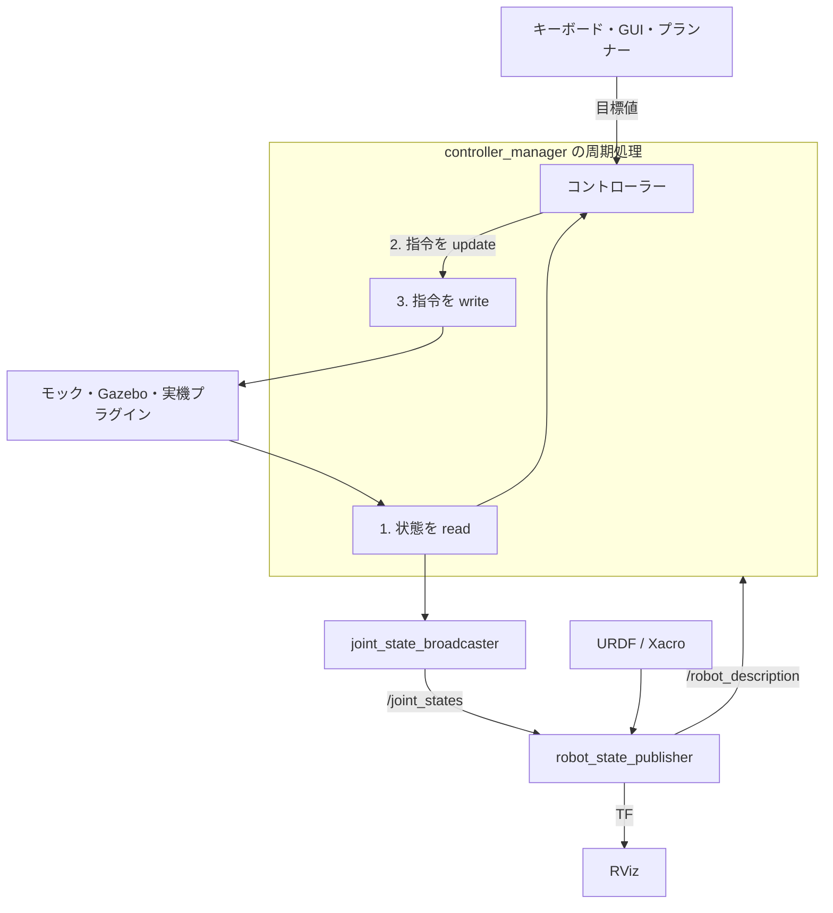

# ros2_control

**ros2_control は、コントローラーと交換可能なハードウェア実装をつなぐ仕組みです。** アプリが目標値を送り、コントローラーが関節への指令に変換し、ハードウェアプラグインがモーターへの書き込みと実測値の読み取りを担当します。同じ関節インターフェースを保てば、モックで開発した構成を実機に移せます。

https://github.com/jinyongnan810/ros-practice/tree/main/8.ros2_control

## 1. 全体の流れ

スタックの起動: [robot.launch.xml](https://github.com/jinyongnan810/ros-practice/blob/main/8.ros2_control/src/robot_bringup/launch/robot.launch.xml)



| 要素                         | 役割                                                              | 設定・実装場所                        |
| ---------------------------- | ----------------------------------------------------------------- | ------------------------------------- |
| URDF / Xacro                 | リンク、関節、指令・状態インターフェースを宣言する                | URDF / Xacro ファイル                 |
| ハードウェアプラグイン       | モーターの実測値と関節状態、関節指令と機器操作を相互変換する      | `<hardware><plugin>` と実装パッケージ |
| リソースマネージャー         | ハードウェアを読み込み、インターフェースを管理する                | コントローラーマネージャー内部        |
| コントローラーマネージャー   | コントローラーのライフサイクルと read → update → write を管理する | `ros2_control_node` と YAML           |
| コントローラー               | アプリの目標値を関節指令に変換する                                | YAML のプラグイン型・パラメーター     |
| Joint state broadcaster      | 関節のフィードバックを `/joint_states` に配信する                 | コントローラーとともに起動            |
| Robot state publisher / RViz | 関節状態から TF を計算し、その結果を表示する                      | launch と RViz 設定                   |

**指令は「動いてほしい値」、状態は「フィードバック」です。** 車輪の `velocity` 指令は rad/s、`position` 状態は rad です。アームは位置指令を受け取り、位置と速度を状態として返せます。通常、同じ指令インターフェースを複数のコントローラーが同時に占有することはできません。

RViz に表示されるのは報告された状態です。画面で動いていても、実際のモーターが動いた証明にはなりません。

## 2. モック・Gazebo・実機を選ぶ

バックエンドの選択: [simple_car.ros2_control.xacro](https://github.com/jinyongnan810/ros-practice/blob/main/8.ros2_control/src/robot_description/urdf/simple_car.ros2_control.xacro)

| バックエンド                      | 動作                                          | 向いている用途                                                  |
| --------------------------------- | --------------------------------------------- | --------------------------------------------------------------- |
| `mock_components/GenericSystem`   | 指令から理想的な状態を作る                    | モーターなしで設定、トピック、コントローラー、launch を確認する |
| `gz_ros2_control/GazeboSimSystem` | Gazebo の物理エンジンを通して指令と状態を扱う | 接触、重力、摩擦、センサーを試す                                |
| 実機用プラグイン                  | 機器に指令を送り、実測値を取得する            | 通信、校正、実際の応答を確認し、ロボットを動かす                |

共通の契約は **関節名と指令・状態インターフェース** です。これらを保てば、ハードウェアを変えてもアプリのトピックやコントローラーの選択を維持できます。通信設定やシミュレーションの調整値は別途必要です。

モックには衝突や現実的なモーター特性はありません。GenericSystem の `calculate_dynamics: true` は、速度指令の積分による位置計算などを有効にします。車輪オドメトリの接続確認には使えますが、摩擦や実機性能の評価には使えません。[Jazzy のモック仕様](https://control.ros.org/jazzy/doc/ros2_control/hardware_interface/doc/mock_components_userdoc.html)も参照してください。

## 3. 関節インターフェースとコントローラーを定義する

**URDF は利用可能なインターフェースを宣言し、YAML はそれを使うコントローラーを選択します。** 両方の関節名を一致させます。

### URDF / Xacro：ハードウェアを公開する

関節インターフェースの宣言: [simple_car.ros2_control.xacro](https://github.com/jinyongnan810/ros-practice/blob/main/8.ros2_control/src/robot_description/urdf/simple_car.ros2_control.xacro)

2 関節のアームでは、ロボットの Xacro 内に次のブロックを追加します。通常の URDF リンク・関節として `arm_joint_1` と `arm_joint_2` を定義したうえで、制御用インターフェースを追加する構成です。

```xml
<ros2_control name="robotic_arm" type="system">
  <hardware>
    <plugin>mock_components/GenericSystem</plugin>
  </hardware>
  <joint name="arm_joint_1">
    <command_interface name="position" />
    <state_interface name="position">
      <param name="initial_value">0.0</param>
    </state_interface>
    <state_interface name="velocity" />
  </joint>
  <joint name="arm_joint_2">
    <command_interface name="position" />
    <state_interface name="position">
      <param name="initial_value">0.0</param>
    </state_interface>
    <state_interface name="velocity" />
  </joint>
</ros2_control>
```

`type="system"` は複数の関節を 1 つのハードウェアコンポーネントにまとめます。例えば、アーム全体の通信バスを 1 つのコンポーネントで管理できます。台車・アーム・グリッパーを別々のコンポーネントとして構成することもできます。

### YAML：関節の制御方法を選ぶ

コントローラーの型とパラメーター: [robot_controllers.yaml](https://github.com/jinyongnan810/ros-practice/blob/main/8.ros2_control/src/robot_bringup/config/robot_controllers.yaml)

`robot_controllers.yaml` のアーム関連部分は次のようになります。

```yaml
controller_manager:
  ros__parameters:
    update_rate: 50
    joint_state_broadcaster:
      type: joint_state_broadcaster/JointStateBroadcaster
    arm_controller:
      type: position_controllers/JointGroupPositionController

arm_controller:
  ros__parameters:
    joints: [arm_joint_1, arm_joint_2]
```

マネージャーのブロックはコントローラー名とプラグイン型を登録し、個別の `arm_controller` ブロックはパラメーターを設定します。このコントローラーが各関節の `position` 指令インターフェースを占有し、broadcaster が関節状態を配信します。

50 Hz は 20 ms ごとの read → update → write を要求する設定です。コントローラーはロード・設定・有効化されてから動作します。spawner がこの遷移を行います。[Jazzy のコントローラーマネージャー仕様](https://control.ros.org/jazzy/doc/ros2_control/controller_manager/doc/userdoc.html)を参照してください。

## 4. モックハードウェアを起動する

XML の起動設定: [robot.launch.xml](https://github.com/jinyongnan810/ros-practice/blob/main/8.ros2_control/src/robot_bringup/launch/robot.launch.xml)

Ubuntu の ROS 2 Jazzy 環境で、必要なパッケージをインストールします。

```bash
sudo apt install ros-jazzy-ros2-control ros-jazzy-ros2-controllers \
  ros-jazzy-robot-state-publisher ros-jazzy-xacro
```

基本的な bringup では、ロボット記述の publisher、コントローラーマネージャー、コントローラーの spawner を起動します。次は `robot.launch.xml` から、その役割が分かる部分を抜粋したものです。RViz と任意の指令 GUI は省略しています。

```xml
<launch>
  <arg name="model"
       default="$(find-pkg-share robot_description)/urdf/simple_car.urdf.xacro" />
  <arg name="controller_config"
       default="$(find-pkg-share robot_bringup)/config/robot_controllers.yaml" />

  <node pkg="robot_state_publisher" exec="robot_state_publisher" output="screen">
    <param name="robot_description"
           value="$(command 'xacro $(var model)')" type="str" />
  </node>

  <node pkg="controller_manager" exec="ros2_control_node" output="both">
    <param from="$(var controller_config)" />
    <param name="robot_description"
           value="$(command 'xacro $(var model)')" type="str" />
  </node>

  <node pkg="controller_manager" exec="spawner" args="joint_state_broadcaster" />
  <node pkg="controller_manager" exec="spawner" args="diff_drive_controller" />
  <node pkg="controller_manager" exec="spawner" args="wheel_joint_controller" />
  <node pkg="controller_manager" exec="spawner" args="arm_controller" />
</launch>
```

`model` は Xacro、`controller_config` は YAML のパスを選びます。`$(command ...)` が Xacro を URDF 文字列に展開し、`type="str"` が文字列パラメーターとして扱うことを指定します。`<param from="..." />` でコントローラー設定を読み込み、各 spawner がコントローラーのロード・設定・有効化を行います。

完全な YAML には台車・回転台・アームの設定が含まれます。前節のアーム部分は設定方法を示す抜粋です。4 つの spawner を起動する場合は、すべてのコントローラーを含む設定を使います。

ロボットのパッケージをビルドした後、ワークスペースのルートで環境を読み込んで起動します。

```bash
source /opt/ros/jazzy/setup.bash
source install/setup.bash
ros2 launch robot_bringup robot.launch.xml
```

パッケージ名と launch 名は参考例のものです。別のロボットでは、そのロボットの記述・YAML・bringup パッケージに対応させます。ハードウェア記述を変更したらスタックを再起動します。

同じ環境を読み込んだ別ターミナルで確認します。

```bash
ros2 control list_hardware_components
ros2 control list_hardware_interfaces
ros2 control list_controllers
ros2 topic echo /joint_states
```

ハードウェアコンポーネントと起動したコントローラーが active になり、アームの位置指令インターフェースが available / claimed になっていることを確認します。指令インターフェースを占有するのは `arm_controller` です。

## 5. 指令を送り、フィードバックを読む

### アームの位置制御

位置コントローラーの設定と指令の配信: [robot_controllers.yaml](https://github.com/jinyongnan810/ros-practice/blob/main/8.ros2_control/src/robot_bringup/config/robot_controllers.yaml), [position_command_gui.py](https://github.com/jinyongnan810/ros-practice/blob/main/8.ros2_control/src/robot_bringup/scripts/position_command_gui.py)

配列は `[arm_joint_1, arm_joint_2]` の順番で、単位は rad です。

```bash
# [arm_joint_1, arm_joint_2], in radians
ros2 topic pub --once /arm_controller/commands \
  std_msgs/msg/Float64MultiArray '{data: [0.5, -0.5]}'
```

配列の順番は YAML の `joints` に従います。モックでは `/joint_states` に目標に対応する位置が現れます。実機では、ドライバーが読み取った実測位置が配信されます。

`JointGroupPositionController` は位置目標を転送します。目標への追従はハードウェア側やアクチュエーターが担い、このコントローラー自身は時刻付き軌道の生成や PID を行いません。時刻と補間を伴う協調動作には、ロボットに適したインターフェースと制限を設定した `joint_trajectory_controller` を使います。[位置コントローラーの仕様](https://control.ros.org/jazzy/doc/ros2_controllers/position_controllers/doc/userdoc.html)を参照してください。

指令 GUI はコントローラーに目標値を送り、`/joint_states` からフィードバックを表示する構成にします。`joint_state_publisher_gui` は URDF 単体のプレビュー用であり、ros2_control のハードウェアへ指令を送るものではありません。

### 移動台車の速度制御

車輪の対応、寸法、指令タイムアウト: [robot_controllers.yaml](https://github.com/jinyongnan810/ros-practice/blob/main/8.ros2_control/src/robot_bringup/config/robot_controllers.yaml)

差動駆動台車では、車輪に `velocity` 指令と `position` / `velocity` 状態インターフェースを公開します。マネージャーの YAML に `diff_drive_controller/DiffDriveController` を登録し、車輪名と寸法を設定します。

```yaml
# Add under controller_manager.ros__parameters:
# diff_drive_controller:
#   type: diff_drive_controller/DiffDriveController

diff_drive_controller:
  ros__parameters:
    left_wheel_names: [front_left_wheel_joint, rear_left_wheel_joint]
    right_wheel_names: [front_right_wheel_joint, rear_right_wheel_joint]
    wheel_separation: 0.45
    wheel_radius: 0.1
    cmd_vel_timeout: 0.5
    odom_frame_id: odom
    base_frame_id: base_link
    enable_odom_tf: true
```

車輪寸法は実際の値をメートルで設定します。コントローラーを起動し、別ターミナルから時刻付きのキーボード指令を送ります。

```bash
ros2 run controller_manager spawner diff_drive_controller
ros2 run teleop_twist_keyboard teleop_twist_keyboard --ros-args \
  -r /cmd_vel:=/diff_drive_controller/cmd_vel \
  -p stamped:=true -p frame_id:=base_link
```

`teleop_twist_keyboard` のインストールが必要です。Jazzy のコントローラーは `TwistStamped` を受け取り、前進速度と旋回角速度を車輪速度に変換します。この例では、新しい指令が 0.5 秒間届かないと移動指令を停止します。

コントローラーは `/diff_drive_controller/odom` と、この設定では `odom → base_link` の TF を配信します。エンコーダーが測るのは車輪の回転なので、空転などによるオドメトリのドリフトは残ります。[差動駆動コントローラーの仕様](https://control.ros.org/jazzy/doc/ros2_controllers/diff_drive_controller/doc/userdoc.html)を参照してください。

## 6. モックから実機へ切り替える

ハードウェアプラグインの選択とモーター ID: [simple_car.ros2_control.xacro](https://github.com/jinyongnan810/ros-practice/blob/main/8.ros2_control/src/robot_description/urdf/simple_car.ros2_control.xacro)

関節名、指令・状態インターフェース、コントローラー YAML、アプリのトピックを維持し、モックプラグインを実機用ドライバーに置き換えて接続パラメーターを渡します。

例えば、アームを実機に接続するハードウェア設定は次のようになります。

```xml
<hardware>
  <plugin>robot_hardware/ArmJointsHardwareInterface</plugin>
  <param name="port_name">/dev/ttyUSB2</param>
  <param name="baud_rate">57600</param>
</hardware>
```

Xacro の `mock_components/GenericSystem` ブロックをこれに置き換えます。関節の位置指令と位置・速度の状態インターフェースは維持します。参考例のドライバーでは、関節ごとの `dxl_id` パラメーターでモーターを対応付けます。

```xml
<joint name="arm_joint_1">
  <param name="dxl_id">15</param>
  <command_interface name="position" />
  <state_interface name="position" />
  <state_interface name="velocity" />
</joint>
```

プラグイン名や接続パラメーターはドライバーによって異なります。ここでの `port_name`、`baud_rate`、`dxl_id` は例の Dynamixel ドライバーが使う設定なので、実際の機器に合わせて変更します。C++ の変更後は再ビルドし、環境を読み込んで再起動すると選択したバックエンドが読み込まれます。

### ドライバーの役割

ドライバーのライフサイクル、read/write、プラグイン登録: [position_hardware_interface.cpp](https://github.com/jinyongnan810/ros-practice/blob/main/8.ros2_control/src/robot_hardware/src/position_hardware_interface.cpp), [robot_hardware.xml](https://github.com/jinyongnan810/ros-practice/blob/main/8.ros2_control/src/robot_hardware/robot_hardware.xml)

| 実装                                 | コードと役割                                                                                                                                                                                                                                                                                                                                                                                                             |
| ------------------------------------ | ------------------------------------------------------------------------------------------------------------------------------------------------------------------------------------------------------------------------------------------------------------------------------------------------------------------------------------------------------------------------------------------------------------------------ |
| モータードライバー                   | [xl330_driver.hpp](https://github.com/jinyongnan810/ros-practice/blob/main/8.ros2_control/src/robot_hardware/include/robot_hardware/xl330_driver.hpp)：Dynamixel SDK を使った通信、動作モード・トルクの設定、位置・速度の読み書き                                                                                                                                                                                        |
| アームのハードウェアインターフェース | [arm_joints_hardware_interface.cpp](https://github.com/jinyongnan810/ros-practice/blob/main/8.ros2_control/src/robot_hardware/src/arm_joints_hardware_interface.cpp)：関節とモーターの対応・プラグイン公開。共通のライフサイクルと read/write は [position_hardware_interface.cpp](https://github.com/jinyongnan810/ros-practice/blob/main/8.ros2_control/src/robot_hardware/src/position_hardware_interface.cpp) に実装 |
| 台車のハードウェアインターフェース   | [base_link_hardware_interface.cpp](https://github.com/jinyongnan810/ros-practice/blob/main/8.ros2_control/src/robot_hardware/src/base_link_hardware_interface.cpp)：駆動輪の速度指令と関節状態を ros2_control に接続                                                                                                                                                                                                     |

| 段階            | 主な処理                                                     |
| --------------- | ------------------------------------------------------------ |
| `on_init`       | インターフェースの検証と設定の解析                           |
| `on_configure`  | 機器への接続と初期フィードバックの取得                       |
| `on_activate`   | 現在位置保持などの初期指令を用意し、アクチュエーターを有効化 |
| `read`          | エンコーダーやセンサーの実測値を関節状態へ変換               |
| `write`         | 関節指令を機器の指令へ変換して送信                           |
| `on_deactivate` | 機構に応じて停止・無効化                                     |

ドライバーはエンコーダー単位、オフセット、方向、ギア比、通信エラーを扱います。共通モーターバスでは、1 つの system プラグインで全アクチュエーターへのアクセスを管理できます。実機のフィードバックには測定値を使います。速度指令の積分で得られるのは推定値です。

独自ドライバーでは `hardware_interface::SystemInterface` を実装し、pluginlib で公開してプラグイン記述 XML をインストールします。選択する前にパッケージをビルドし、環境を読み込みます。[ハードウェアコンポーネント実装ガイド](https://control.ros.org/jazzy/doc/ros2_control/hardware_interface/doc/writing_new_hardware_component.html)を参照してください。

切り替え後は、選択中のプラグインと実測フィードバックを確認してから小さな動作指令を試します。単位、方向、関節制限、停止動作も確認します。コントローラーとの接続方法は共通でも、実際の動きはアクチュエーターの応答によって決まります。

## 7. 物理が必要なら Gazebo を使う

Gazebo プラグイン、起動、トピックブリッジ: [simple_car.gazebo.xacro](https://github.com/jinyongnan810/ros-practice/blob/main/8.ros2_control/src/robot_description/urdf/simple_car.gazebo.xacro), [gazebo.launch.xml](https://github.com/jinyongnan810/ros-practice/blob/main/8.ros2_control/src/robot_bringup/launch/gazebo.launch.xml), [gazebo_bridge.yaml](https://github.com/jinyongnan810/ros-practice/blob/main/8.ros2_control/src/robot_bringup/config/gazebo_bridge.yaml)

Gazebo ではコントローラーのインターフェースを保ちながら、動力学、衝突、センサーを扱えます。Jazzy / Harmonic では次をインストールします。

```bash
sudo apt install ros-jazzy-ros-gz-sim ros-jazzy-ros-gz-bridge ros-jazzy-gz-ros2-control
```

ハードウェアプラグインに `gz_ros2_control/GazeboSimSystem` を選び、ロボットモデルに Gazebo 統合プラグインを追加します。そのプラグインにコントローラー YAML を渡し、Gazebo 内にモデルを生成します。

統合プラグインが **Gazebo 内部に**コントローラーマネージャーを作ります。そのマネージャーに対してコントローラーを起動し、同じロボット用の独立した `ros2_control_node` を重複起動しないようにします。モデルと launch の構成は [Gazebo 統合仕様](https://control.ros.org/jazzy/doc/gz_ros2_control/doc/index.html)を参照してください。

関節状態、コントローラー指令、オドメトリは ros2_control が提供する ROS トピックです。クロックやカメラなど Gazebo 固有のトピックは必要に応じてブリッジし、シミュレーション時刻を使う ROS ノードでは `use_sim_time` を有効にします。各関節の指令インターフェースには 1 つの制御元を割り当てます。

## 8. 制御経路に沿って調べる

確認する設定とフィードバック実装: [robot_controllers.yaml](https://github.com/jinyongnan810/ros-practice/blob/main/8.ros2_control/src/robot_bringup/config/robot_controllers.yaml), [position_hardware_interface.cpp](https://github.com/jinyongnan810/ros-practice/blob/main/8.ros2_control/src/robot_hardware/src/position_hardware_interface.cpp)

| 症状                           | 最初に確認すること                                                       |
| ------------------------------ | ------------------------------------------------------------------------ |
| spawner が待ち続ける           | マネージャーの起動、ロボット記述、名前空間、manager パス                 |
| コントローラーを有効化できない | 関節名とインターフェース、ハードウェア状態、他のコントローラーによる占有 |
| 台車が指令に反応しない         | active 状態、トピック名、`TwistStamped` 型、時刻、タイムアウト           |
| 別の関節が動く                 | YAML の関節順、アクチュエーター対応、関節軸、方向変換                    |
| フィードバックが変わらない     | 選択中のバックエンド、機器との通信、ドライバーの `read()`                |
| RViz の関節 TF が動かない      | `/joint_states`、broadcaster、robot state publisher                      |
| オドメトリの距離や旋回量が違う | 車輪半径、左右間隔、方向、エンコーダーの単位                             |

どのバックエンドでも、目標値 → コントローラー → ハードウェア指令 → ハードウェア状態 → broadcaster → 可視化の経路をたどります。モックで接続を確認し、必要に応じて物理を加え、実機では実測フィードバックを検証します。
